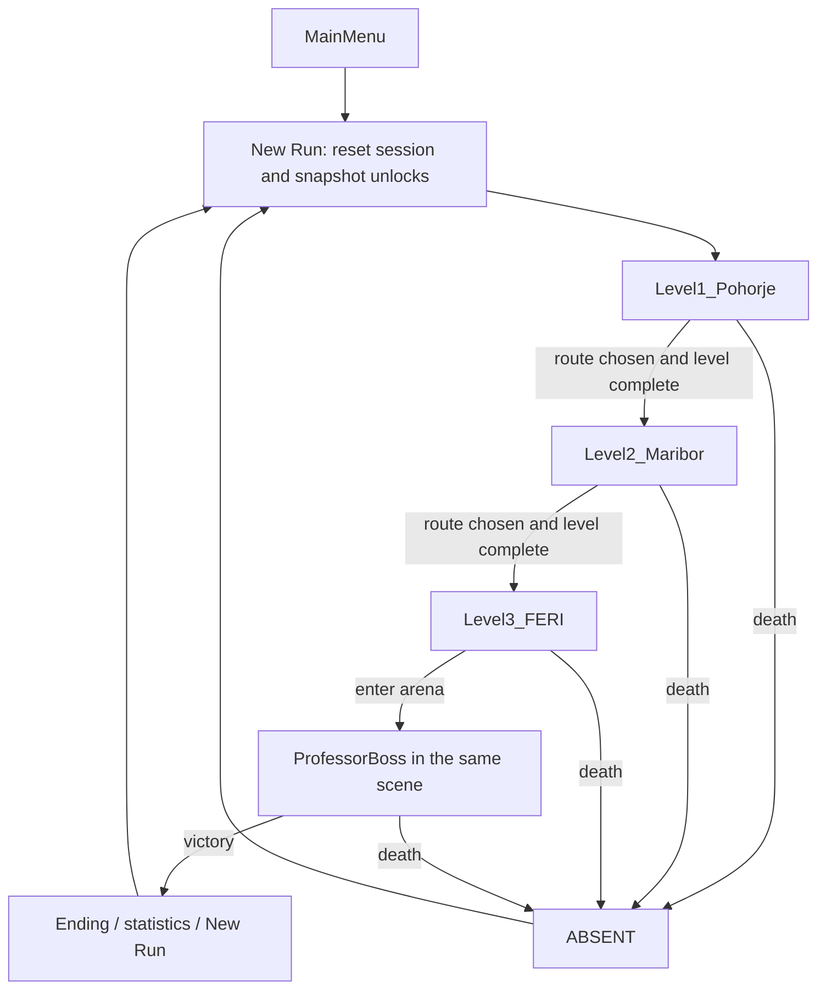

# BOKI: LATE TO FERI — Architecture

> **Status:** implementation plan, not a description of existing code.  
> **Project:** Unity 6 (`6000.6.7f1`), Universal 3D / URP, C#.  
> **Related:** [Story.md](Story.md) (narrative), [Gameplay.md](Gameplay.md) (mechanics, route matrix, acceptance tests).

## 1. Technical Goal and Boundaries

**Two developers have 48 hours.** The architecture must deliver a playable version quickly, without unnecessary abstractions or new Unity packages.

See [README.md](../README.md#development-setup) for the target hardware. Primary build: Windows x86_64, 1280×720, Low, at least 30 FPS **measured on the target machine**. 60 FPS is a stretch goal, not a promise. Linux development is supported, but Linux Editor FPS does not replace a Windows player build test.

**Style:** simple third-person 3D, PS1/low-poly/VHS, URP Forward. No HDRP, ray tracing, or expensive volumetric effects.

**Principles:**

1. Playability first, graphics and cutscenes later.
2. Use simple MonoBehaviour components rather than a heavy framework.
3. Share one enemy AI implementation per type, with different prefabs/materials per level.
4. Assign one developer ownership of each Unity scene or prefab until integration is complete. Follow [AGENTS.md](../AGENTS.md#scope-and-git) for branch and agent authorization rules.
5. Do not add packages without agreement; use the included Input System and URP.

## 2. Repository Structure

```text
boki/
├── Game/                          # Unity project; open this in Unity Hub
│   ├── Assets/
│   │   ├── Scenes/                # Existing directory; add new scenes here
│   │   │   ├── Gameplay_Test.unity
│   │   │   ├── Combat_Test.unity
│   │   │   ├── MainMenu.unity
│   │   │   ├── Level1_Pohorje.unity
│   │   │   ├── Level2_Maribor.unity
│   │   │   └── Level3_FERI.unity
│   │   ├── Scripts/               # Player/, Combat/, Enemies/, Routes/, Core/, UI/, Boss/
│   │   ├── Prefabs/               # Player/, Enemies/, Environment/, Interactables/
│   │   ├── Art/                   # Models/, Textures/, Materials/
│   │   ├── Audio/
│   │   ├── UI/
│   │   └── Settings/              # Existing URP configurations
│   ├── Packages/
│   ├── ProjectSettings/
│   └── .gitignore
├── docs/
│   ├── Story.md
│   ├── Gameplay.md
│   └── Architecture.md
├── README.md
├── AGENTS.md
└── CLAUDE.md
```

The layout includes both implemented and proposed content. `SampleScene.unity` is the template scene; `Gameplay_Test.unity` contains M1 movement, and `Combat_Test.unity` contains the M2 combat prototype. M4 adds `Level1_Pohorje.unity`, `Level2_Maribor.unity`, and `Level3_FERI.unity` as short grayboxes; the main menu remains proposed. Create and move content in the **Unity Editor** to preserve `.meta` references. Never rename a scene with a plain `mv` without its corresponding `.meta` file. Follow [Unity asset guidance](../AGENTS.md#unity-changes) for external script creation and pending imports.

**Code layering:** deterministic gameplay rules live in engine-free `Boki.<Domain>.Rules` assemblies (`Scripts/<Domain>/Rules/`, `noEngineReferences`) with matching EditMode test assemblies under `Assets/Tests/EditMode/`. MonoBehaviour adapters, UI, and Editor tools sit above them and never the reverse. Scenes load only through `RunSession`, and `ProjectSettings/EditorBuildSettings.asset` lists the three production scenes. The engineering rules, templates, and audit script are in the `boki-unity-architecture` skill (`.agents/skills/boki-unity-architecture/`).

**Exclude from version control:** `Game/Library/`, `Game/Temp/`, `Game/Logs/`, `Game/Obj/`, local builds, and caches. **Include:** `Game/Assets/` with `.meta` files, `Game/Packages/`, `Game/ProjectSettings/`, `docs/`, and agent configuration. These inclusion rules do not authorize an agent to commit or push.

## 3. Proposed Modules and Ownership

| Module / script | Responsibility | Minimal dependencies | Primary owner |
|---|---|---|---|
| `ScooterController` | WASD, steering, jump, boost through `CharacterController` | Input System | Gameplay dev |
| `ThirdPersonCamera` | Follow, mouse sensitivity, limit excessive clipping | Player transform | Gameplay dev |
| `PlayerHealth` | HP, damage, death | RunSession | Gameplay dev |
| `AutoLaser` | Nearest target, damage, cooldown | EnemyHealth | Gameplay dev |
| `EnemyHealth` | HP, death, XP drop and kill count (no battery reward) | Pickup / RunSession | Gameplay dev |
| `MeleeEnemy` | Move toward player, contact damage | Player transform | Gameplay dev |
| `RangedEnemy` / `EnemyProjectile` | Targeting, slow projectiles | Player transform | Gameplay dev |
| `GuiltChaser` | `Distant → Warning → Chase → Reposition` | Player transform | Gameplay dev |
| `LightBattery` | Drain, recharge, effect at 0 | Enemy speeds, HUD | Gameplay dev |
| `UpgradeManager` | XP thresholds, one of three upgrades, pause | RunSession, UI | Gameplay dev / integration |
| `PersistentUnlocks` | 3 permanent C flags | PlayerPrefs | Gameplay dev |
| `RunSession` | HP, battery, upgrades, route choices, reset, scene transitions | Unity scene manager | Gameplay dev |
| `RouteManager` | Allowed connections, locks, route selection | RunSession | Gameplay dev |
| `RouteGate` | Trigger/collider, lock message | RouteManager | World dev + integration |
| `LevelExit` | Unlock milestone and next scene transition | RunSession, PersistentUnlocks | World dev + integration |
| `ProfessorBoss` | 2 attacks, entrance-based modifier | PlayerHealth, RunSession | Gameplay dev |
| `HUDController` | HP, battery, XP, objective, route status | RunSession | World/UI dev |

Names are **proposals** and can change if all project references stay consistent. During the jam, combine systems when a shorter implementation is clearer; each system does not need its own script.

The first momentum iteration adds engine-free `Boki.Player.Rules` (`ScooterMotion` and `ScooterMotionTuning`) with EditMode behavior tests, consumed by the existing `ScooterController`. The dedicated `Player_Model_Test` arena and `Boki_Rigged_Test` prefab variant provide an owned rigged-player playtest without changing the shared prefab or milestone scene assets. The second iteration adds downhill/air-strafe gains to those rules. `ScooterPresentation` and UI `BoostView` consume controller state in the owned test scene for visual motion, FOV and boost feedback; they do not own gameplay state. Movement scope and retained prototype values are defined in [Movement.md](Movement.md) and [Gameplay.md M1 baseline](Gameplay.md#m1-movement-baseline).

The scooter-light implementation on this branch adds engine-free `Boki.Battery.Rules`, composed by `RunState`, with fractional drain, capacity/charge carry, persistent combat-space recharge timers, and the empty-battery enemy movement modifier. `LightBattery` binds the single active player to `RunSession` ticking; scenes without a light adapter retain their standalone behavior. `BatteryCombatSpace` and `BatteryCharge` adapt authored pickup locations, and `BatteryView` / `ScooterDarkness` present charge and the switchable darkness overlay. Production grayboxes and `Player_Model_Test` are wired by an idempotent upgrade helper; see [scooter light verification](plans/scooter-light-verification.md).

M2 implements scene-local `PlayerHealth`, `EnemyHealth`, `AutoLaser`, and `MeleeEnemy`, with `CombatSession` and `CombatView` for HP display, death, and retry. M3 adds `RunSession`, deterministic run/route rules, gate adapters, and two isolated route test scenes. `PlayerHealth` and `CombatSession` optionally bind to the session while retaining standalone M2 behavior. HP and choices carry from the Forest test scene to City; Retry starts a fresh Forest run. M4 adds three owned graybox level scenes, configured session destinations, City-to-FERI loading, and a shared classroom arrival marker. M4 Retry returns to Pohorje; the original M3 test flow retains its defaults. M5 adds permanent C unlock saving at exits and classroom entry, reads saved flags only on new runs, and opens short C lanes in the three production scenes. M6 adds regular kill/battery rewards, shared ranged projectiles, light pressure, Guilt/panic movement, a route-modified professor fight, victory/New Run, a scripted City C turn-back, and explicit branch/arena rendering isolation in the production scenes. XP upgrades and visual polish remain future work. See [M2 handoff](plans/M2-verification.md), [M3 handoff](plans/M3-verification.md), [M4 handoff](plans/M4-verification.md), [M5 handoff](plans/M5-verification.md), and [M6 handoff](plans/M6-verification.md) for setup and validation limits.

## 4. Runtime State

### 4.1 `PersistentUnlocks` (Survives Application Restarts)

```text
forestC: false
cityC:   false
feriC:   false
```

For the MVP, use `PlayerPrefs` with three explicit keys, e.g. `boki.unlock.forestC`, `boki.unlock.cityC`, and `boki.unlock.feriC`. Save **when the unlock is earned**, call `PlayerPrefs.Save()`, and read it again at the start of a new run. Do not use Unity scene serialization for permanent progress.

### 4.2 `RunSession` (Reset on Death / New Run)

```text
health = 100
battery = 100
batteryCapacity = 100
combatSpaceTime = 0
upgradeSelections = 0
xp = 0
upgrades = []
forestChoice = none
cityChoice = none
feriChoice = none
killCount = 0
startedAt = currentTime
availableUnlocks = snapshot(PersistentUnlocks)
```

Keep **one active instance** across `MainMenu` and the three gameplay scenes, using `DontDestroyOnLoad` or a simple bootstrap. Prevent duplicate instances. `New Run` **resets** the existing session; do not copy leftovers from the previous run.

**Invariant:** immediately save permanent unlocks earned during a run, but **do not change `availableUnlocks`** until `New Run`. C routes therefore activate on the next attempt. Carry `health`, `battery`, and upgrades across scenes. [Gameplay.md §4](Gameplay.md#4-game-state-and-saving-rules) owns the game-state rules.

### 4.3 `RouteManager` and `RouteGate`

Implement availability and lock precedence from [Gameplay.md §2–4](Gameplay.md#2-branching-route-graph). Do not maintain a second route matrix here.

`RouteManager` calculates each gate's state. `RouteGate` applies its blocking collider, selection trigger, and HUD message. On crossing an `AVAILABLE` gate, immediately store the choice and close the alternatives. M4 gates also control an opaque rear seal and an initially inactive branch encounter root. Only selection opens that branch's rear seal and activates its enemies; alternatives remain sealed at both ends, following [Gameplay §4](Gameplay.md#4-game-state-and-saving-rules). Once chosen, the saved `chosenRoute` determines gate state; do not reopen unchosen gates by recalculating their earlier availability.

### 4.4 Unlock Milestone Integration

Use the milestone timing specified in [Gameplay.md §1 and §4](Gameplay.md#4-game-state-and-saving-rules):

- `ExitForest`: persist the earned unlock, then `LoadScene(Level2_Maribor)`.
- `ExitCity`: persist the earned unlock, then `LoadScene(Level3_FERI)`.
- `EnterBossArena`: persist the earned unlock, then start the boss.

Milestone handlers must be idempotent: repeated trigger contact must not create duplicate transitions, repeat saving, or start the boss twice.

## 5. Scene Flow



Level1, Level2, and Level3 each have a shared opening, an A/B/C variant, and a shared exit. Build **3 gameplay scenes, not 9 separate scenes**. `LevelExit` can hold exit logic and check that the player has chosen a route in the current level.

**Early demonstration:** launch `Level1_Pohorje` → `Level2_Maribor` → `Level3_FERI` → classroom from the menu. C routes can remain blocked in the first version until physically built. Do not present unlocked but unfinished routes as passable.

## 6. Combat and Enemy Flow

```text
ScooterController + ThirdPersonCamera
  -> AutoLaser (nearest enemy in range)
      -> EnemyHealth.TakeDamage()
          -> Death -> XPPickup + BatteryGain
                -> RunSession.xp / LightBattery
                -> UpgradeManager (upgrade selection)

MeleeEnemy / RangedEnemy / GuiltChaser / ProfessorBoss
  -> PlayerHealth.TakeDamage()
      -> Health == 0 -> DeathScreen -> New Run
```

Use two regular AI types rather than new AI for each level:

| Type | Pohorje | Maribor | FERI |
|---|---|---|---|
| Melee | Forest shadow | Izgubljeni meščan | Student shadow |
| Ranged | Watcher | Red Watcher | Flying exam papers |
| Immortal threat | Guilt, short chase | Guilt, longer chase | Silhouette / final chase |

`GuiltChaser` is not a second boss and the laser cannot kill it. Disable chase AI during the boss fight and keep only its silhouette. The combat-space loop and time-driven increases to Guilt appearance frequency, chase speed, and damage are specified in [Gameplay.md §5](Gameplay.md#5-loop-within-each-route). `Boki.Enemies.Rules` implements the pressure table and ambient lifecycle in `GuiltState`, composed by `RunState`. `GuiltChaser` can bind to that shared state with `useRunSession`, or retain standalone state for `Enemy_Test`. `GuiltCombatSpace` reports occupancy; overlapping volumes do not duplicate time, leaving retains progress, and run/level transitions reset it. `RunSession` suspends loading and ends pursuit on accepted boss entry. Scene owners still need to assign combat volumes and connect the shared pause/upgrade authority and scripted-sequence suspension. Safe placement checks ground, capsule clearance, distance, position behind the player, and camera visibility; an unavailable marker leaves Guilt hidden until a safe placement can provide the full warning. See [Guilt lifecycle handoff](plans/Guilt-lifecycle-verification.md) for setup and validation limits. Replenish selected-route encounters within the existing active-enemy caps. The professor uses `Exam Barrage` and `Deadline Slam`; route modifiers are specified in [Gameplay.md §7](Gameplay.md#7-branch-configurations).

### Revised Loop Integration Requirements

The historical M6 handoff describes kill-based recharge and fixed ambient chases; those checks do not establish compliance with the revised design or the current branch. The scooter-light implementation uses arena charges and never adds a kill recharge reward. Arena charge collection/recharge follows [Gameplay §5](Gameplay.md#battery-charges-and-action-feedback). Keep scene-local spawn/pickup adapters separate from deterministic run progression, capacity, upgrade eligibility, and Guilt pressure rules. Store per-level accumulated pressure and per-space pickup timer progress so reentry cannot reset either. Upgrade counts, XP, capacity and charge survive scene changes; pressure resets at the next level. One shared pause authority must freeze combat, battery drain, ambient pressure, spawning and pickup recharge during pause/upgrade selection/loading, with scripted sequences additionally suspending ambient Guilt.

Add deterministic behavior tests for thresholds and queued selections, additive caps, charge-percentage preservation, healing eligibility, pressure boundaries and snapshots, same-level reentry/next-level reset, and New Run cleanup. Use PlayMode/manual checks for valid spawn placement, selected-route ownership, accessible arena charges, repeated audiovisual feedback, pause/resume, and Panic Mode proximity/boost activation. Rebalance the boss against actual upgraded builds before claiming final duration or difficulty acceptance. Keep Windows verification open until performed on Windows target hardware.

## 7. Project Settings and Performance

1. **Editor → Asset Serialization:** `Force Text`. **Version Control:** `Visible Meta Files`, if available.
2. Use **Input System**, already included in the URP template. Do not mix in legacy `Input.GetAxis` calls without agreement.
3. Movement uses an **arcade CharacterController**, not realistic scooter physics. The model can lean visually.
4. Use **URP Forward**, one main light, and as few additional shadow-casting lights as possible. Use simple fog and limited visibility rather than volumetric fog.
5. Display at 1280×720 Low; use `renderScale ≈ 0.75–0.9` if needed. Allow VHS/glitch effects to be disabled.
6. Cap active regular enemies at **8 / 12 / 8** (Forest/City/FERI). Use simple colliders and no ragdolls.
7. Before the jam ends, make a **Windows x86_64 player build** and test the city horde, FERI boss, and most heavily lit scene. Record actual FPS. Linux Editor results do not substitute for this check.

## 8. Concurrent Work: Git and Unity

The branch policy and agent commit restrictions live in [AGENTS.md](../AGENTS.md#scope-and-git). Suggested developer branches are `feat/gameplay` and `feat/world`; a separate task can use `feat/<feature>`.

**File ownership to reduce conflicts:**

- Developer A: `Assets/Scripts/Player`, `Combat`, `Enemies`, `Routes`, `Core`, `Boss`; owns `Gameplay_Test.unity`.
- Developer B: `Assets/Scenes/Level1_*`, `Level2_*`, `Level3_*`, `Assets/Art`, `Assets/Prefabs/Environment`, UI, audio.
- **Joint integration:** player prefab, `RouteGate`, boss prefab, scene transitions. Agree on one editor before changing a shared prefab.

Human contributors should synchronize the correct branch before starting work, integrate upstream changes deliberately, inspect conflicts, stage only task files, and use clear commit messages such as `Add scooter controller` or `Block locked city routes`. Agents follow the authorization rules in AGENTS.md rather than treating this workflow as permission to commit, push, merge, or rebase.

**Never edit the same `.unity` scene or `.prefab` simultaneously.** Keep `.meta` files with their assets. For Unity YAML conflicts, establish scene ownership first; never resolve blindly with `git checkout --ours` or `--theirs`.

## 9. Development Milestones

### Scope and Completion

The original M1–M7 sequence was a **minimum 48-hour implementation roadmap**, not a complete checklist for the game described in Story.md and Gameplay.md. Reaching the classroom or winning a graybox run establishes the playable foundation; it does not complete the story, route content, progression, or presentation.

The roadmap below separates that foundation from completion of the **currently documented design**. It adds no new game mechanics. M1–M6 retain their identifiers so existing plans and handoffs remain valid. M7 is the minimum release gate; M8–M12 cover the remaining design and its final release validation. Work on later content can proceed in parallel where ownership permits. Performance checks begin during grayboxing, rather than waiting for M7 or M12.

These are acceptance targets, **not completion claims**. Use the implementation notes in §3 and the linked verification handoffs for recorded progress and outstanding checks. A script, scene builder, or automated smoke check alone does not establish that a milestone is playable or complete.

### Playable Foundation and Minimum Release

| Step | Deliverable | Acceptance criterion |
|---|---|---|
| M1 — Movement prototype | Placeholder Boki/scooter, third-person camera, movement, jump, boost | Controls work in the test arena; obstacles and jumps are readable; no new Console errors. Use the approved [M1 baseline](Gameplay.md#m1-movement-baseline); later movement proposals are not implicit requirements. |
| M2 — Combat prototype | Automatic laser, melee enemy, HP, death and retry | Laser respects range and occlusion; enemies can die; Boki can die; `ABSENT` and retry restore a playable test. Use the [M2 baseline](Gameplay.md#m2-combat-baseline). |
| M3 — Run and route rules | Shared session, route selection, gate states and cross-level filtering | Selection immediately seals alternatives; physical blockers and messages agree with the [canonical matrix and lock priority](Gameplay.md#3-allowed-route-matrix); deterministic tests cover reachable choices and lock edge cases. |
| M4 — Connected graybox | Pohorje → Maribor → FERI → shared classroom, with A/B branches | Every allowed built route reaches its exit; unchosen branches are sealed at both ends and their encounters stay inactive; HP and choices survive transitions; death starts a fresh Pohorje run without duplicate session/UI objects. This is a traversal slice, not finished level content. |
| M5 — Persistent discoveries | Three saved C flags, next-run snapshot, short secret-route integration | Forest exit, City exit, and classroom entry save the appropriate discoveries once; death and application restart preserve them; no current-run gate opens from a new discovery. Built C routes remain subject to the route matrix; unfinished routes are not presented as passable. Cover saving and next-run timing with deterministic tests. |
| M6 — Winnable gameplay loop | Ranged enemies, arena battery charges, replenishment, escalating Guilt, basic XP/upgrade progression, professor and route modifiers | A connected run can be won or lost. Empty battery increases enemy speed and can recover; Guilt warns, pursues, grants the specified panic advantage, and stops chasing during the boss. M6 includes contact-collected XP, paused three-option selection, shared gameplay pause, and functional Rave Overdrive, Turbo Skiro, Bigger Battery, and Emergency Snack, with scene carry/reset and deterministic rule tests. Combat spaces support staying for XP/upgrades while Guilt appearance frequency, speed, and damage escalate with lingering per [Gameplay.md §5](Gameplay.md#5-loop-within-each-route); fixed periodic chases alone do not satisfy this revised loop. Both boss attacks are readable; E_B reinforcement and optional E_C `POWER OFF` behavior work. Verify City C's turn-back escape and branch/arena isolation wherever those routes are built. |
| M7 — Minimum jam release | Playable entry flow, essential HUD/control prompts, pause/back, win/lose/retry/New Run, concise ending and a Windows build | A new player can start, understand the objective and locks, reach the professor, see the Saturday reveal, and retry without Editor intervention. Meet the agreed minimum route scope below. Test Windows x86_64 at 1280×720 Low on the target Ryzen 5600G; record ≥30 FPS in the City horde, boss, and most heavily lit scene. Record deferred content explicitly. |

**Minimum release scope:** retain at least A/B routes in each scene with visibly different gameplay, meaningful downstream consequences, permanent unlock saving, and the core loop above. [Story.md §9](Story.md#9-minimum-scope-for-48-hours) explicitly requires at least one playable secret C passage; the other two can reuse short modules. [Gameplay.md §9](Gameplay.md#9-implementation-priorities-for-two-developers-in-48-hours) places C-branch construction after the core systems. These differ in priority wording: use Story's explicit minimum for this release gate, and confirm any proposal to ship with no playable C route before reducing that scope. All three complete C experiences belong to M8.

### Completion of the Documented Game

| Step | Deliverable and canonical scope | Acceptance criterion |
|---|---|---|
| M8 — Distinct routes and encounters | Complete all nine short variants within the three shared-start/shared-ending scenes. Follow [Gameplay.md §6–7](Gameplay.md#6-content-and-enemy-progression-by-level) and [Story.md §3](Story.md#3-story-beats-and-script): Forest slalom / gondola jumps / rave tunnel; City car slalom / riverbank ranged pressure / Podzemni prehod escape; FERI corridor / courtyard ambush / service traps and panel. | Each chosen path leads into a combat space supporting the stay-or-leave loop and bounded enemy replenishment. Each route differs through obstacles, encounter composition, rewards/costs, and atmosphere, rather than only color. Include the guaranteed Forest C pickup, City C side-opening escape, and FERI C traps and optional panel. All allowed routes converge safely; isolation and enemy caps remain correct. Play the [three canonical example runs](Gameplay.md#11-three-example-runs), including fresh-save and unlocked-save cases. |
| M9 — Complete upgrade roster and progression balance | Extend M6's working progression with Double Trouble and Panic Mode, completing the six upgrades in [Story.md §5](Story.md#5-upgrades-and-replay-motivation). Finish full-roster eligibility, stacking, feedback, and progression balance. | Retain M6's XP collection, pause, selection, carry/reset and first four upgrades; M9 does not introduce those foundational systems. Kills feed progression; crossing a threshold offers three random options and applies exactly one choice before resuming. Verify all six effects, including Double Trouble and Panic Mode, battery capacity/current-charge adjustment, and healing limits. XP/upgrades carry across scenes and reset on death/New Run; deterministic progression rules have behavior tests. Verify the six-selection ceiling, cumulative thresholds, capped additive bonuses, recovery eligibility and exact Panic Mode conditions in Story §5; recheck ordinary versus extended-stay pacing. |
| M10 — Story from Bellevue to the ending | Implement [Story.md §2–3](Story.md#3-story-beats-and-script): skippable Bellevue prologue, objective/tutorial, route-specific Guilt appearances, discovery cues, level transitions, classroom introduction, Saturday reveal, and death presentation. | The 07:58 → 07:59 → 08:00 / 88:88 watch sequence, unlock explanations, professor/Boki dialogue, Guilt's final corridor disappearance and boss silhouette, and final victory text appear at their specified beats. Preserve Slovenian quotations verbatim. Skipping presentation leaves controls, route state, unlocks, and boss startup correct; a concise M7 ending is expanded to the full scripted sequence. |
| M11 — Presentation, UI, audio and replay feedback | Complete the menu and HUD, upgrade cards, pause/back flow, readable lock/pickup/attack feedback, end statistics, and [Story.md §6–7](Story.md#6-visual-and-audio-direction) art/audio direction. | Show HP, battery, XP, objective and boost readiness; results show routes, time, kills, upgrades and secret unlocks. Boki/scooter, enemy reskins and recognizable location backdrops fit the documented palette. Techno, Guilt warning/heartbeat, laser, scooter impacts, transition glitches, school bell and pre-boss quiet support the story. PS1/VHS effects remain restrained and switchable; hazards stay readable on Low. |
| M12 — Full-design release validation | Integrate M8–M11, tune difficulty/resources/pacing, and repeat platform validation on the finished content. Use [Gameplay.md §8–11](Gameplay.md#8-performance-target-and-unity-settings), §10 below, and [Story.md §2.3](Story.md#23-intended-duration). | Complete fresh-save, persistent-save, death, restart and victory runs; validate all route/unlock combinations and boss variants. Playtest the approximately 7–12 minute successful-run target and 1–2 minute boss target. Record final Windows target-hardware FPS in the worst sections with finished effects/audio; fix blockers and missing assets. Publish a handoff listing Inspector/setup requirements, checks, and any remaining deviations. |

M8–M11 are all required before calling the **documented design complete**; completing one does not substitute for the others. M12 is the final integration gate, not a promise that the current implementation has passed it. Exact implementation values and unsettled movement choices remain with their canonical documents; this roadmap does not resolve them by implication.

**Milestone dependency:** M6 owns the working stay-or-leave loop and its basic progression; it cannot be called complete with placeholder XP/upgrades. M8 finishes route content rather than introducing the combat-space system. M9 completes and balances the upgrade roster rather than deferring the progression needed by M6. Prove the revised loop in one Pohorje space first, then integrate it into the built route scope across all three levels before accepting M6. The full-design six-selection rules remain canonical in Story §5; a four-upgrade intermediate build must not claim full-roster progression acceptance.

### Two-Day Jam Priorities

Protect M1–M7 first. Deliver short routes and simple presentation before expanding content. Bring forward inexpensive story cues, essential audio warnings, and upgrade work when they improve the playable slice, while respecting scene ownership. If time runs short, shorten routes and reduce effects; keep route consequences and permanent discoveries. Explicitly list deferred M8–M11 items in the handoff so an MVP is not mistaken for the full game.

Advanced effects, extra environmental stories beyond the script, additional animations, a long intro, and the optional Hard mode are stretch work. They do not block completion of the currently documented core design.

## 10. Tests Before Integration and Submission

Use the manual route checklist in [Gameplay.md §10](Gameplay.md#10-acceptance-tests-manual-checks). For deterministic route changes, add or update EditMode tests as required by [AGENTS.md](../AGENTS.md#validation-and-documentation). Also verify:

- `New Run` restores 100 HP, 100 battery, zero XP, and no route choices, while preserving permanent unlocks.
- `RouteGate` cannot confirm twice; `LevelExit` cannot transition twice.
- Locked gates physically block Boki and disable selection triggers, using the precedence in Gameplay.md.
- New unlocks do not change the current run's snapshot.
- Scene transitions do not duplicate `RunSession`, input listeners, or HUD.
- Every FERI route reaches the **same** boss arena.
- The Windows build has no missing assets, and its scene list includes every gameplay scene.

## 11. Definition of Done for Each Feature

- Works in Unity Play Mode without new Console errors.
- Leaves unrelated scenes and prefabs untouched.
- Includes required `.meta` files and no generated `Library/` content.
- Documents required Inspector setup in the PR description or task notes.
- The other developer can open the synchronized project without repairing missing files manually.
- Records changes to story, route connections, or numeric values in the relevant canonical document.
