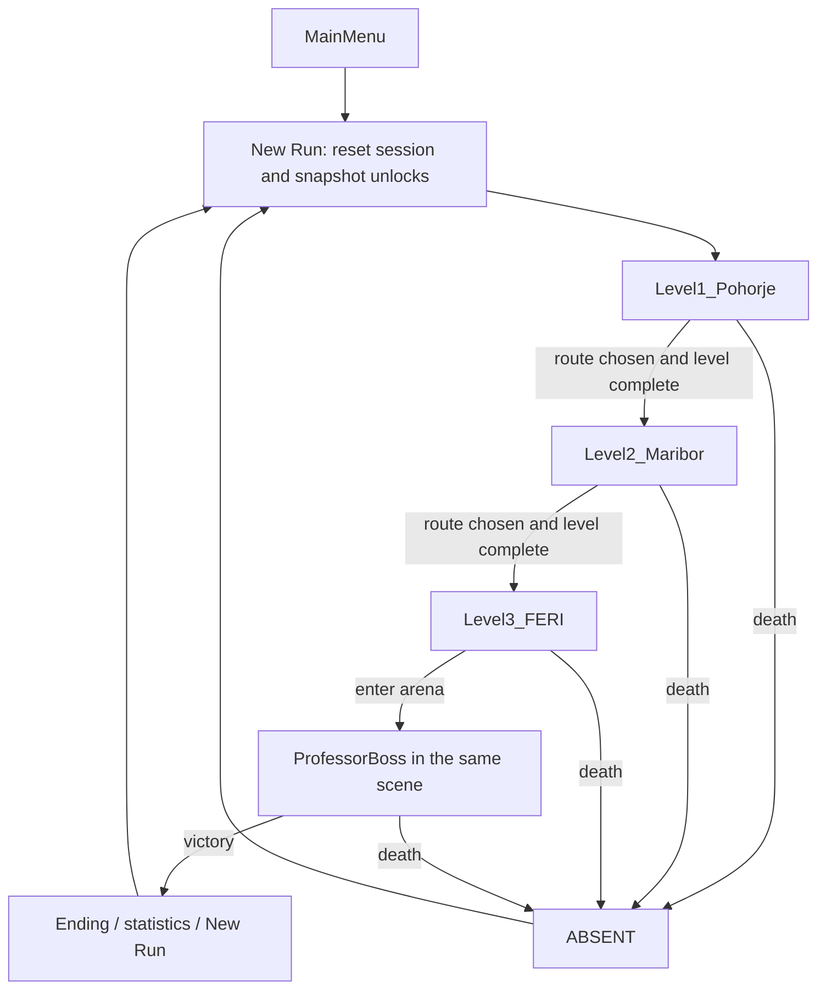

# BOKI: LATE TO FERI — Architecture

> **Status:** implementation plan, not a description of existing code.  
> **Project:** Unity 6 (`6000.6.7f1`), Universal 3D / URP, C#.  
> **Related:** [Story.md](Story.md) (narrative), [Gameplay.md](Gameplay.md) (mechanics, route matrix, acceptance tests).

## 1. Technical Goal and Boundaries

**Two developers have 48 hours.** The architecture must deliver a playable version quickly, without unnecessary abstractions or new Unity packages.

See [README.md](../README.md#development-setup) for the target hardware. Primary build: Windows x86_64, 1280×720, Low, at least 30 FPS **measured on the target machine**. 60 FPS is a stretch goal, not a promise. Linux development is supported, but Linux Editor FPS does not replace a Windows player build test.

**Style:** simple third-person 3D, PS1/low-poly/VHS, URP Forward. No HDRP, ray tracing, or expensive volumetric effects.

**Principles:**

1. Playability first, graphics and cutscenes later.
2. Use simple MonoBehaviour components rather than a heavy framework.
3. Share one enemy AI implementation per type, with different prefabs/materials per level.
4. Assign one developer ownership of each Unity scene or prefab until integration is complete. Follow [AGENTS.md](../AGENTS.md#scope-and-git) for branch and agent authorization rules.
5. Do not add packages without agreement; use the included Input System and URP.

## 2. Repository Structure

```text
boki/
├── Game/                          # Unity project; open this in Unity Hub
│   ├── Assets/
│   │   ├── Scenes/                # Existing directory; add new scenes here
│   │   │   ├── Gameplay_Test.unity
│   │   │   ├── Combat_Test.unity
│   │   │   ├── MainMenu.unity
│   │   │   ├── Level1_Pohorje.unity
│   │   │   ├── Level2_Maribor.unity
│   │   │   └── Level3_FERI.unity
│   │   ├── Scripts/               # Player/, Combat/, Enemies/, Routes/, Core/, UI/, Boss/
│   │   ├── Prefabs/               # Player/, Enemies/, Environment/, Interactables/
│   │   ├── Art/                   # Models/, Textures/, Materials/
│   │   ├── Audio/
│   │   ├── UI/
│   │   └── Settings/              # Existing URP configurations
│   ├── Packages/
│   ├── ProjectSettings/
│   └── .gitignore
├── docs/
│   ├── Story.md
│   ├── Gameplay.md
│   └── Architecture.md
├── README.md
├── AGENTS.md
└── CLAUDE.md
```

The layout includes both implemented and proposed content. `SampleScene.unity` is the template scene; `Gameplay_Test.unity` contains M1 movement, and `Combat_Test.unity` contains the M2 combat prototype. Main menu and level scenes remain proposed. Create and move content in the **Unity Editor** to preserve `.meta` references. Never rename a scene with a plain `mv` without its corresponding `.meta` file. Follow [Unity asset guidance](../AGENTS.md#unity-changes) for external script creation and pending imports.

**Exclude from version control:** `Game/Library/`, `Game/Temp/`, `Game/Logs/`, `Game/Obj/`, local builds, and caches. **Include:** `Game/Assets/` with `.meta` files, `Game/Packages/`, `Game/ProjectSettings/`, `docs/`, and agent configuration. These inclusion rules do not authorize an agent to commit or push.

## 3. Proposed Modules and Ownership

| Module / script | Responsibility | Minimal dependencies | Primary owner |
|---|---|---|---|
| `ScooterController` | WASD, steering, jump, boost through `CharacterController` | Input System | Gameplay dev |
| `ThirdPersonCamera` | Follow, mouse sensitivity, limit excessive clipping | Player transform | Gameplay dev |
| `PlayerHealth` | HP, damage, death | RunSession | Gameplay dev |
| `AutoLaser` | Nearest target, damage, cooldown | EnemyHealth | Gameplay dev |
| `EnemyHealth` | HP, death, XP/battery drop | Pickup / RunSession | Gameplay dev |
| `MeleeEnemy` | Move toward player, contact damage | Player transform | Gameplay dev |
| `RangedEnemy` / `EnemyProjectile` | Targeting, slow projectiles | Player transform | Gameplay dev |
| `GuiltChaser` | `Distant → Warning → Chase → Reposition` | Player transform | Gameplay dev |
| `LightBattery` | Drain, recharge, effect at 0 | Enemy speeds, HUD | Gameplay dev |
| `UpgradeManager` | XP thresholds, one of three upgrades, pause | RunSession, UI | Gameplay dev / integration |
| `PersistentUnlocks` | 3 permanent C flags | PlayerPrefs | Gameplay dev |
| `RunSession` | HP, battery, upgrades, route choices, reset, scene transitions | Unity scene manager | Gameplay dev |
| `RouteManager` | Allowed connections, locks, route selection | RunSession | Gameplay dev |
| `RouteGate` | Trigger/collider, lock message | RouteManager | World dev + integration |
| `LevelExit` | Unlock milestone and next scene transition | RunSession, PersistentUnlocks | World dev + integration |
| `ProfessorBoss` | 2 attacks, entrance-based modifier | PlayerHealth, RunSession | Gameplay dev |
| `HUDController` | HP, battery, XP, objective, route status | RunSession | World/UI dev |

Names are **proposals** and can change if all project references stay consistent. During the jam, combine systems when a shorter implementation is clearer; each system does not need its own script.

M2 implements scene-local `PlayerHealth`, `EnemyHealth`, `AutoLaser`, and `MeleeEnemy`, with `CombatSession` and `CombatView` for HP display, death, and retry. `RunSession`, rewards, and cross-scene state remain future work; the M2 components do not yet have those dependencies. See [M2 handoff](plans/M2-verification.md) for the delivered setup and validation limits.

## 4. Runtime State

### 4.1 `PersistentUnlocks` (Survives Application Restarts)

```text
forestC: false
cityC:   false
feriC:   false
```

For the MVP, use `PlayerPrefs` with three explicit keys, e.g. `boki.unlock.forestC`, `boki.unlock.cityC`, and `boki.unlock.feriC`. Save **when the unlock is earned**, call `PlayerPrefs.Save()`, and read it again at the start of a new run. Do not use Unity scene serialization for permanent progress.

### 4.2 `RunSession` (Reset on Death / New Run)

```text
health = 100
battery = 100
xp = 0
upgrades = []
forestChoice = none
cityChoice = none
feriChoice = none
killCount = 0
startedAt = currentTime
availableUnlocks = snapshot(PersistentUnlocks)
```

Keep **one active instance** across `MainMenu` and the three gameplay scenes, using `DontDestroyOnLoad` or a simple bootstrap. Prevent duplicate instances. `New Run` **resets** the existing session; do not copy leftovers from the previous run.

**Invariant:** immediately save permanent unlocks earned during a run, but **do not change `availableUnlocks`** until `New Run`. C routes therefore activate on the next attempt. Carry `health`, `battery`, and upgrades across scenes. [Gameplay.md §4](Gameplay.md#4-game-state-and-saving-rules) owns the game-state rules.

### 4.3 `RouteManager` and `RouteGate`

Implement availability and lock precedence from [Gameplay.md §2–4](Gameplay.md#2-branching-route-graph). Do not maintain a second route matrix here.

`RouteManager` calculates each gate's state. `RouteGate` applies its blocking collider, selection trigger, and HUD message. On crossing an `AVAILABLE` gate, immediately store the choice and close the alternatives. Once chosen, the saved `chosenRoute` determines gate state; do not reopen unchosen gates by recalculating their earlier availability.

### 4.4 Unlock Milestone Integration

Use the milestone timing specified in [Gameplay.md §1 and §4](Gameplay.md#4-game-state-and-saving-rules):

- `ExitForest`: persist the earned unlock, then `LoadScene(Level2_Maribor)`.
- `ExitCity`: persist the earned unlock, then `LoadScene(Level3_FERI)`.
- `EnterBossArena`: persist the earned unlock, then start the boss.

Milestone handlers must be idempotent: repeated trigger contact must not create duplicate transitions, repeat saving, or start the boss twice.

## 5. Scene Flow



Level1, Level2, and Level3 each have a shared opening, an A/B/C variant, and a shared exit. Build **3 gameplay scenes, not 9 separate scenes**. `LevelExit` can hold exit logic and check that the player has chosen a route in the current level.

**Early demonstration:** launch `Level1_Pohorje` → `Level2_Maribor` → `Level3_FERI` → classroom from the menu. C routes can remain blocked in the first version until physically built. Do not present unlocked but unfinished routes as passable.

## 6. Combat and Enemy Flow

```text
ScooterController + ThirdPersonCamera
  -> AutoLaser (nearest enemy in range)
      -> EnemyHealth.TakeDamage()
          -> Death -> XPPickup + BatteryGain
                -> RunSession.xp / LightBattery
                -> UpgradeManager (upgrade selection)

MeleeEnemy / RangedEnemy / GuiltChaser / ProfessorBoss
  -> PlayerHealth.TakeDamage()
      -> Health == 0 -> DeathScreen -> New Run
```

Use two regular AI types rather than new AI for each level:

| Type | Pohorje | Maribor | FERI |
|---|---|---|---|
| Melee | Forest shadow | Izgubljeni meščan | Student shadow |
| Ranged | Watcher | Red Watcher | Flying exam papers |
| Immortal threat | Guilt, short chase | Guilt, longer chase | Silhouette / final chase |

`GuiltChaser` is not a second boss and the laser cannot kill it. Disable chase AI during the boss fight and keep only its silhouette. The professor uses `Exam Barrage` and `Deadline Slam`; route modifiers are specified in [Gameplay.md §7](Gameplay.md#7-branch-configurations).

## 7. Project Settings and Performance

1. **Editor → Asset Serialization:** `Force Text`. **Version Control:** `Visible Meta Files`, if available.
2. Use **Input System**, already included in the URP template. Do not mix in legacy `Input.GetAxis` calls without agreement.
3. Movement uses an **arcade CharacterController**, not realistic scooter physics. The model can lean visually.
4. Use **URP Forward**, one main light, and as few additional shadow-casting lights as possible. Use simple fog and limited visibility rather than volumetric fog.
5. Display at 1280×720 Low; use `renderScale ≈ 0.75–0.9` if needed. Allow VHS/glitch effects to be disabled.
6. Cap active regular enemies at **8 / 12 / 8** (Forest/City/FERI). Use simple colliders and no ragdolls.
7. Before the jam ends, make a **Windows x86_64 player build** and test the city horde, FERI boss, and most heavily lit scene. Record actual FPS. Linux Editor results do not substitute for this check.

## 8. Concurrent Work: Git and Unity

The branch policy and agent commit restrictions live in [AGENTS.md](../AGENTS.md#scope-and-git). Suggested developer branches are `feat/gameplay` and `feat/world`; a separate task can use `feat/<feature>`.

**File ownership to reduce conflicts:**

- Developer A: `Assets/Scripts/Player`, `Combat`, `Enemies`, `Routes`, `Core`, `Boss`; owns `Gameplay_Test.unity`.
- Developer B: `Assets/Scenes/Level1_*`, `Level2_*`, `Level3_*`, `Assets/Art`, `Assets/Prefabs/Environment`, UI, audio.
- **Joint integration:** player prefab, `RouteGate`, boss prefab, scene transitions. Agree on one editor before changing a shared prefab.

Human contributors should synchronize the correct branch before starting work, integrate upstream changes deliberately, inspect conflicts, stage only task files, and use clear commit messages such as `Add scooter controller` or `Block locked city routes`. Agents follow the authorization rules in AGENTS.md rather than treating this workflow as permission to commit, push, merge, or rebase.

**Never edit the same `.unity` scene or `.prefab` simultaneously.** Keep `.meta` files with their assets. For Unity YAML conflicts, establish scene ownership first; never resolve blindly with `git checkout --ours` or `--theirs`.

## 9. Development Milestones

| Step | Minimum result | Acceptance criterion |
|---|---|---|
| M1 | Empty arena, placeholder Boki, camera | WASD, jump, boost work without Console errors |
| M2 | AutoLaser, melee, PlayerHealth | Melee dies; Boki can lose and retry |
| M3 | `RunSession`, `RouteManager` | Choosing A closes B; Forest A/B filter City routes |
| M4 | 3 graybox scenes | Full route to FERI and the classroom is passable |
| M5 | Persistent C unlock | Unlock saves but applies only next run |
| M6 | Ranged, light, Guilt, boss | Full run can be won or lost |
| M7 | PS1/VHS polish, Windows build | Playable, measured ≥30 FPS on target hardware |

### Two-Day Jam Priorities

**Must have:** core systems, at least A/B routes per scene, one clear consequence per choice, boss, and actual unlock saving. **Should have:** three C routes, full upgrade selection, audio, atmospheric transitions. **Could have:** advanced effects, extra environmental story, long intro cutscene. When time runs short, shorten levels instead of spending the final hours perfecting lighting.

## 10. Tests Before Integration and Submission

Use the manual route checklist in [Gameplay.md §10](Gameplay.md#10-acceptance-tests-manual-checks). For deterministic route changes, add or update EditMode tests as required by [AGENTS.md](../AGENTS.md#validation-and-documentation). Also verify:

- `New Run` restores 100 HP, 100 battery, zero XP, and no route choices, while preserving permanent unlocks.
- `RouteGate` cannot confirm twice; `LevelExit` cannot transition twice.
- Locked gates physically block Boki and disable selection triggers, using the precedence in Gameplay.md.
- New unlocks do not change the current run's snapshot.
- Scene transitions do not duplicate `RunSession`, input listeners, or HUD.
- Every FERI route reaches the **same** boss arena.
- The Windows build has no missing assets, and its scene list includes every gameplay scene.

## 11. Definition of Done for Each Feature

- Works in Unity Play Mode without new Console errors.
- Leaves unrelated scenes and prefabs untouched.
- Includes required `.meta` files and no generated `Library/` content.
- Documents required Inspector setup in the PR description or task notes.
- The other developer can open the synchronized project without repairing missing files manually.
- Records changes to story, route connections, or numeric values in the relevant canonical document.
