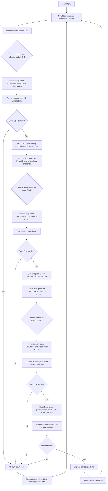
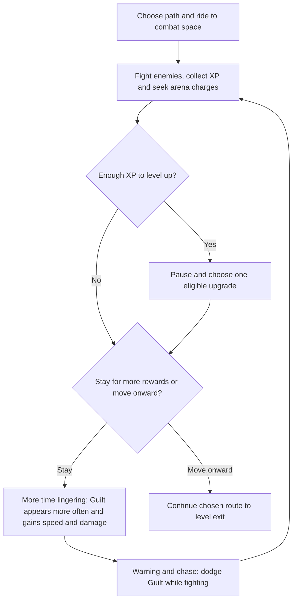

# BOKI: LATE TO FERI — Gameplay

This document specifies the decision system and gameplay loop. See [Story.md](Story.md) for scenes, dialogue, and atmosphere, [Architecture.md](Architecture.md) for Unity architecture and implementation, and [Movement.md](Movement.md) for how scooter movement works.

## 0. Gameplay Pillars and Controls

**Core loop:** Boki rides an electric scooter through branching routes. An automatic rave laser kills enemies, whose drops grant XP; battery charges placed around combat spaces recharge the light. Choosing a route immediately locks the alternatives. Each chosen path leads into a combat space where Boki can stay to kill enemies, collect XP, and gain upgrades. The longer he lingers, the more frequently Guilt appears and the faster and harder it attacks, pressuring him to move toward the exit. After three levels, he fights the professor. Death resets temporary progress; permanent C-route unlocks remain.

| Control | Action |
|---|---|
| `WASD` | Move / steer the scooter |
| Mouse | Rotate the third-person camera |
| `Space` | Jump |
| `Left Shift` | Short **boost** (the consistent term; do not call it “dash”) |
| `E` | Interact with the `POWER OFF` panel and other interactive objects |
| `Esc` | Pause / back |
| Automatic | Laser targets the nearest enemy in range; nearby XP orbs float toward Boki for collection; contact collects arena battery charges |

**Visual target:** low-poly PS1/VHS horror, with obstacles and attacks readable even on Low settings. **Successful run duration:** approximately 7–12 minutes, including the boss.

**Status:** values and designs here are an initial specification, not evidence that these systems already exist in the Unity project.

### M1 Movement Baseline

WASD movement is relative to the camera's horizontal facing. Boki turns toward the velocity direction; diagonal input is normalized. The retained Inspector tuning is 6 m/s movement, 540°/s visual turning, a 1.2 m jump, and gravity of 25 m/s². The approved momentum iteration adds 60 m/s² ground acceleration, 35 m/s² air acceleration, 25 m/s² ground braking, and preservation of horizontal velocity when releasing input in the air. Jump buffering, coyote time and landing friction grace each use an initial 0.1 s window. A timed landing jump preserves momentum and now adds a bounded bunny-hop bonus under Movement.md §5.5. Ground/air overspeed decay is initially 6/0.75 m/s², with overspeed steering limited to 360°/s. See [Movement.md](Movement.md) for implementation scope and deferred proposals.

The second momentum pass allows downhill speed gain (initial slope gain 0.5) and camera-relative air-strafe gains (18 m/s², limited to generating at most 3× base riding speed). Timed forward landing hops now add 1.5 m/s within the same 3× limit. The first jump, holding jump, late jumps, stationary hops and reverse-input hops receive no bonus; faster downhill momentum is not clamped to the strafe-gain limit. Ground braking remains available. See [Movement §5–6](Movement.md#541-air-strafe-speed-gain) for the detailed model.

Pressing Left Shift activates a 1.75× boost for 0.35 s, followed by a 1 s cooldown after the boost ends. Activation requires ground contact. An active boost can continue through a jump, with gradual air steering and a soft speed decay afterward; holding Shift does not activate another boost. These values are the approved prototype baseline and can be tuned through playtesting.

In the M1 test arena, Escape releases the cursor and a left click recaptures it. Movement and look input are suppressed while the cursor is released or the application is unfocused; release held movement, jump, and boost controls before resuming input. This testing behavior does not implement the later pause menu.

### M2 Combat Baseline

The automatic laser fires instantaneous pulses at the nearest visible living regular enemy within 10 m of the beam origin. Each pulse deals 6 damage, with a 0.24 s interval (25 damage per second, unchanged from the earlier 10 damage every 0.4 s, but with faster shots and impacts). Environment geometry blocks the beam; an occluded nearest enemy is skipped in favor of the nearest visible enemy. A brief beam visual shows each shot; there is no projectile travel or fire button.

The initial melee prototype has 60 HP and moves at 4.5 m/s (raised from 3 m/s so crowds stay a threat to a 6 m/s rider). Contact attacks deal 10 damage with a 0.75 s interval per enemy; damage is not applied every rendered frame. The initial contact distance is 0.9 m between controller centers, measured in 3D so jumping can avoid contact. Walls block contact damage. These Inspector values are a prototype baseline for playtesting.

M2 starts Boki at the canonical 100 HP. At zero HP, combat and player controls stop, `ABSENT` appears, and `Retry` restarts the combat test scene with fresh health and enemies. This scene-local retry is temporary until M3 introduces `RunSession`; it does not implement routes, persistence, XP, or battery rewards.

## 1. Main Gameplay Flowchart



**Rules:** no return to a previous scene during the same run. HP, battery, and upgrades carry into the next level. **A newly unlocked C route becomes available only at the start of the next run.** Entering the chosen section immediately records the choice and locks the other gates in that level; do not wait until the section ends.

**Time budget:** prologue 20–30 s (skippable) + Pohorje 2–3 min + Maribor 3–4 min + FERI approach 1–2 min + professor 1–2 min = approximately **7 min 20 s – 11 min 30 s** with the prologue. The target is **7–12 min**; the boss is counted once.

## 2. Branching Route Graph


A solid line is available when its source route is chosen. A dashed line also requires the corresponding permanent unlock. **Every connection not shown is locked in the current run**, even if the player has all permanent unlocks.

## 3. Allowed Route Matrix

| Previous choice | Allowed next A/B/C routes | Locked by previous choice |
|---|---|---|
| `F_A` | `C_A`, `C_B` | `C_C` |
| `F_B` | `C_A`, `C_C`* | `C_B` |
| `F_C`* | `C_B`, `C_C`* | `C_A` |
| `C_A` | `E_A`, `E_B` | `E_C` |
| `C_B` | `E_B`, `E_C`* | `E_A` |
| `C_C`* | `E_A`, `E_C`* | `E_B` |

`*` requires the corresponding globally unlocked secret route.

**Important:** combinations such as `F_B -> C_C -> E_A` require `C_C` to have been permanently discovered. A choice such as `F_B -> C_B` is **never allowed**, even though City B is open by default. This distinction separates the two kinds of lock.

### 3.1 First Run and Visible Branching

All three C routes start locked, so `F_B` **temporarily forces** `C_A`, and `C_B` **temporarily forces** `E_B`. This is intentional: it shows the consequences of unlocking routes. The design does **not** guarantee two open options at every first-run fork. Demonstrate `F_A`, which offers `C_A` or `C_B` in Maribor, or show a second run with C routes unlocked.

Guaranteeing at least two active choices at **every** first-run fork would require changing the connection matrix or unlocking C routes earlier. Do not make that change just before the jam deadline: it requires updates to the flowchart, `RouteManager`, and all route tests.

## 4. Game State and Saving Rules

### PersistentState — PlayerPrefs or Small JSON

```text
unlockedForestC: bool = false
unlockedCityC:   bool = false
unlockedFeriC:   bool = false
```

Copy these flags into `RunState.availableUnlocks` at the start of a new run. **Use the copied flags**, not newly changed global values, so C routes cannot open during the run in which they were discovered.

### RunState — Reset on Death or New Run

```text
forestChoice: null | A | B | C
cityChoice:   null | A | B | C
feriChoice:   null | A | B | C
health:       100
battery:      100
batteryCapacity: 100
combatSpaceTime: 0 (accumulated within the current level)
upgradeSelections: 0
xp:           0
upgrades:     []
killCount:    0
startTime:    ...
availableUnlocks: snapshot of persistent unlocks
```

### Gates and Messages

Each fork has these states:

- `AVAILABLE`: bright visible sign, gate open.
- `PERSISTENT_LOCK`: padlock and “DISCOVER ON ANOTHER RUN”.
- `ROUTE_LOCK`: dark roots / shadowed gate and “SEALED BY YOUR PREVIOUS PATH”.
- `SELECTED`: chosen route; the other routes in this scene close immediately.

**Lock display priority:** first check the connection from the previous choice (`ROUTE_LOCK`), then the permanent unlock (`PERSISTENT_LOCK`), otherwise `AVAILABLE`. If both locks apply, display **`ROUTE_LOCK`** and give the player one clear explanation. `SELECTED` applies only after crossing the actual selection trigger.

**Physics / UX:** `ROUTE_LOCK` and `PERSISTENT_LOCK` require an enabled blocking collider, a disabled selection trigger, and the correct message when crossing is attempted. `AVAILABLE` requires a passable entrance and an active trigger. Once the player chooses, immediately close the alternatives and prevent a second choice.

**Branch isolation:** unchosen branches must be sealed at both their entrance and their exit into the shared ending. Rear seals are opaque and physically block reentry, so the player cannot inspect or enter another branch from the merge. Keep rear seals closed until their branch is selected; open only the selected branch's rear seal. Route-local enemies activate only after that branch is chosen. Unchosen branch enemies remain inactive: they cannot move, attack, or become laser targets. Preplaced groups remain useful for authored encounters, but do not satisfy the replenishing combat-space loop in §5 on their own.

After selection, suppress rendering of unchosen branch interiors while retaining their physical blockers and visible entrance/rear seals. Entering the boss arena suppresses all approach-route rendering, deactivates approach encounters, and closes a solid arena entrance seal. Rendering changes never open a route or remove its collision. New Run reloads the original scene visibility. Complete the City C side-door escape before leaving Podzemni prehod.

Choosing `A/B/C` requires no extra menu confirmation: entering an allowed **fork trigger** selects it. Forbidden gates need physical colliders, not just closed visuals, so their behavior is consistent and readable.

### RouteManager Pseudocode

```csharp
// At the start of a new run:
run.availableUnlocks = savedUnlocks.Clone();

bool IsCityAllowed(CityRoute city)
{
    bool linked = forestChoice switch {
        ForestRoute.A => city == CityRoute.A || city == CityRoute.B,
        ForestRoute.B => city == CityRoute.A || city == CityRoute.C,
        ForestRoute.C => city == CityRoute.B || city == CityRoute.C,
        _ => false
    };
    return linked && (city != CityRoute.C || run.availableUnlocks.cityC);
}

bool IsFeriAllowed(FeriRoute feri)
{
    bool linked = cityChoice switch {
        CityRoute.A => feri == FeriRoute.A || feri == FeriRoute.B,
        CityRoute.B => feri == FeriRoute.B || feri == FeriRoute.C,
        CityRoute.C => feri == FeriRoute.A || feri == FeriRoute.C,
        _ => false
    };
    return linked && (feri != FeriRoute.C || run.availableUnlocks.feriC);
}

// On successfully leaving the forest:
savedUnlocks.forestC = true;
SavePersistentUnlocks();
// On leaving the city:
savedUnlocks.cityC = true;
SavePersistentUnlocks();
// On first entering the boss arena:
savedUnlocks.feriC = true;
SavePersistentUnlocks();
```

Forest C requires `run.availableUnlocks.forestC`; A and B are always open. At each fork, immediately save `forestChoice`, `cityChoice`, or `feriChoice`, close the other gates, and let the player continue along the chosen route. **Never reset the choice before loading the next scene.**

## 5. Loop Within Each Route

**Route structure:** choose a path, travel along it, then reach a combat space. The combat space gives Boki room to ride, dodge, fight regular enemies, and collect XP and arena battery charges. Route-specific obstacles, encounters, and rewards still distinguish A/B/C, and the existing route locks and shared endings remain in effect.

**Stay or leave:** lingering provides further opportunities to kill enemies, earn XP, and choose upgrades, making Boki stronger before the next level and the professor. Encounters must support continued fighting while the player stays, rather than exhausting a single fixed group and leaving an empty farming area. Replenish enemies within the existing active-enemy caps; do not increase the cap to create pressure. Guilt makes that extra preparation increasingly dangerous and motivates the player to finish the level.



Upgrade eligibility, stacking and the two-card exception when only two rewards remain are specified in [Story §5](Story.md#5-upgrades-and-replay-motivation).

### Guilt Pressure While Lingering

Guilt is an immortal pressure system. As Boki spends longer lingering in a combat space, Guilt's appearances become more frequent, its chase movement speed increases, and its damage increases. Boki gains strength through XP and upgrade choices; Guilt grows more dangerous with time spent lingering. Its escalation is time-driven, not triggered by selecting an upgrade.

Keep warning cues and the existing panic-speed response so players can recognize a chase and attempt an escape. Guilt does not become a killable enemy or gain new attack types through this escalation. Its purpose is to make staying for another reward a risk, while moving toward the level exit remains the player's goal. Scripted appearances, including the Podzemni prehod turn-back, remain part of the route content.

### Initial Playtest Rules: Pressure and Timing

These are approved implementation starting values, subject to recorded playtest tuning. Count only active gameplay time inside combat spaces. Pause, upgrade selection, loading, and scripted sequences suspend the pressure clock and ambient phase timers. Accumulate combat-space time across spaces within the same level; leaving and reentering never resets it. Outside combat spaces, suspend ambient pursuit and retain its clock/phase progress for reentry. Reset pressure and ambient phase state on entering the next level or starting a new run. Scripted Guilt sequences run separately and suspend ambient pressure/pursuit so they cannot overlap; boss entry ends pursuit entirely.

The first 20 accumulated combat-space seconds in each level are an ambient grace period. Then give a 1.5-second warning and a 6-second chase. After each chase, wait the rest interval below before the next warning. Select the rest interval from accumulated time when rest begins; snapshot chase speed and damage when warning begins, keeping them unchanged through that chase. Apply the existing ×1.3 empty-battery speed multiplier afterward. Contact damage has a one-second cooldown. Preserve the existing +25% movement advantage for 2 seconds with a 5-second cooldown.

| Accumulated combat-space time | Rest after chase | Chase speed before battery modifier | Contact damage |
|---|---:|---:|---:|
| Less than 30 s | 18 s | 4.5 m/s | 10 |
| 30–59.999 s | 15 s | 5.0 m/s | 12 |
| 60–89.999 s | 12 s | 5.5 m/s | 14 |
| 90–119.999 s | 9 s | 6.0 m/s | 16 |
| 120 s and above | 6 s | 6.5 m/s | 18 |

Frequency, base speed, and damage stop escalating at the last row. Upgrade selection never causes escalation. Scripted appearances retain their authored timing rather than using this ambient table.

### Enemy Replenishment and Exits

Use predefined spawn points on the selected route. On first active occupation, populate the combat space with 15 regular enemies, one every 0.25 s so the arena visibly floods, retrying unavailable positions during active gameplay until the opening group is placed. Reentry does not grant another opening group. Opening enemies may be visible; place them on valid, collision-free ground at least 8 m from Boki and spread them around the markers.

There is no desired population or maximum active enemy count. Continue spawning one enemy every 4 seconds in Pohorje/FERI and every 3 seconds in Maribor regardless of how many survive. Intervals decrease linearly over the first 120 accumulated active combat-space seconds to 2 seconds and 1.5 seconds respectively, then remain there. Missed attempts never accumulate. Regular enemies snapshot +25% original health and +15% original damage per accumulated combat minute when spawned, with continuous linear scaling and no strength cap; existing enemies keep their spawn stats. This applies to melee contact and ranged projectile damage, not the professor or Guilt.

Use the same per-level combat clock as Guilt pressure: leaving a space retains progress, overlapping spaces do not double-count, pause/upgrade selection/loading/scripted sequences freeze progress, and the next level or New Run resets it. Replenishment requires active occupation; later spawns must also be outside camera view. If no safe point exists, wait. Death does not trigger immediate replacement. Stop replenishment on leaving the space, scene transition, boss entry, or terminal outcome. Preserve route-specific melee/ranged compositions. The player must manage the growing population by killing and dodging enemies and choosing upgrades.

Exits have no kill quota or forced wave clear. Leaving early sacrifices potential upgrades. Preserve authored traversal requirements, including City C's side-door escape. Boss entry remains a commitment with the existing physical entrance seal.

### Combo Counter

Each laser hit on an enemy adds 1 to a combo; a Double Trouble second hit adds another. The combo resets to 0 whenever Boki takes damage or dies, and when the laser stops (scene change). There is no timeout and no combo reward yet. A right-edge `xN COMBO` counter appears from 2 hits, turns orange from 10, pops on each hit, and fades red when a streak of 2 or more is broken.

### Battery Charges and Action Feedback

Regular kills drop small floating XP orbs and increment the kill count. Within 3 metres, orbs home toward Boki at 12 m/s and grant XP on arrival; attraction and hovering pause with gameplay. Regular kills **never recharge battery or drop battery charges**. After maximum level they still count as kills, without XP or battery rewards. Battery starts at 100, drains at 1.5/s during active gameplay (including the boss), and retains the existing zero-charge speed penalty. Current charge and upgraded capacity carry between scenes.

At healthy battery charge, a broad white light at the scooter headlamp reveals the riding area in all directions, including elevated obstacles (initial tuning: 28 m maximum radius). Rendering layers keep this strong surrounding light off Boki and the scooter model; a separate, restrained unshadowed fill follows the camera-facing side of the rider, keeping his front, back and sides readable as he turns without making him glow. The lamp is white from startup through depletion during ordinary riding. During the existing Guilt warning/chase cue, the surrounding lamp pulses smoothly between white and red at two cycles per active second, with restrained brightness modulation; the rider fill stays white. Pause freezes the pulse, and clearing the warning restores white immediately. As the charge fraction falls, brightness and reach fade gradually, and the darkness overlay's clear area contracts toward the rider and darkens with them. At zero, the surrounding light switches off while a faint local fill barely reveals Boki and the scooter. Recharging restores visibility proportionally to charge.

Place contact-collected +25 charges at predefined, visible locations around each combat space so Boki must ride to recover light. Scatter locations across usable riding lanes, away from spawn hazards and inaccessible geometry; do not place every charge beside the entrance or let them follow the player. Forest C retains its guaranteed pickup and Lent has more recovery opportunities. Collection clamps to upgraded capacity and happens once per available charge; leave a charge available when already full.

**Initial arena pickup tuning:** three charge locations per combat space, initially charged, each recharging 20 active seconds after collection. Use a clear depleted indicator and return cue. Recharge timers run only while that space is occupied during active gameplay; preserve remaining timers across leaving/reentry so this cannot refill charges instantly. Unchosen spaces stay inactive. Provide two equivalent charge locations inside the boss arena because the approach becomes inaccessible. Initial Lent variation: four charge locations with the same +25 recovery and 20-active-second recharge. These pickup counts/timers are initial tuning, to validate with encounter density and battery upgrades; route-specific variations must be recorded. Recovery rewards from upgrade selection remain an explicit exception to arena-only recharge, not a kill reward.

Keep combat fast and continuously readable: frequent brief laser, impact, hit, XP-collection and battery-collection effects/sounds; distinct cues for charge availability, boost and enemy attacks. Avoid long effects or camera interruptions on ordinary kills. Bound simultaneous effects and repeated audio voices, vary repeated sounds subtly, and prioritize Guilt warnings, projectile/ground-hazard telegraphs and low-battery cues over background impacts. Pause freezes gameplay effects/timers; offer restrained, switchable screen effects and preserve Low-settings readability. Do not introduce extra enemy types or attacks to create activity.

XP thresholds, upgrade eligibility, stacking, and Panic Mode are canonical in [Story §5](Story.md#5-upgrades-and-replay-motivation). Recheck roughly three selections in ordinary runs and five or six only with risky extended stays against the 7–12 minute target.

**Keep Guilt AI simple:** use `Distant -> Warning -> Chase -> Reposition`. Spawn at one of 2–3 marked points behind the player while offscreen. If stuck on geometry or too far away, reposition invisibly to the next point. Disable Guilt AI during the boss and use only a decorative mesh.

## 6. Content and Enemy Progression by Level

| Level | Main hazards | Enemies | Guilt | Maximum regular enemies | Focus |
|---|---|---|---|---:|---|
| Pohorje | Trees, logs, visual ground pits | `Melee`, then late `Ranged` | Short chase | 8 | Movement tutorial, forest emphasis |
| Maribor | Wreckage, cars, fences | Same 2 AI types, more HP and ranged enemies | Longer chase | 12 | Greater combat pressure |
| FERI | Doors, ramps replacing stairs, warning circles | Reskins of the same 2 AI types | Final corridor appearance | 8 | Professor boss |

**Enemy progression uses shared AI, not three separate systems:**

- `MeleeChaser` follows Boki and deals contact damage nearby. Forest: dark shadow; city: `Izgubljeni meščan`; FERI: student shadow.
- `RangedShooter` fires slow projectiles toward Boki on a cooldown. Forest/city: Watcher; FERI: floating exam papers using the same AI and projectile system.
- `GuiltChaser` is immortal, uses separate logic, and stays mostly offscreen. Nearby, it grants +25% panic speed for 2 s with a 5 s cooldown. Appearance frequency, chase speed, and damage escalate with lingering as specified in §5.
- `ProfessorBoss` uses Exam Barrage and Deadline Slam. Different entrances change only a small boss setting.

## 7. Branch Configurations

| Route | Environment / distinct experience | Reward / cost |
|---|---|---|
| `F_A` Strmina | Slalom through trees, more melee hordes | More XP and combat |
| `F_B` Gondola | Slope, obstacle jumps, less combat | Faster, less XP |
| `F_C` Rave tunel | Narrow dark tunnel, light glitches | Guaranteed pickup, greater battery pressure |
| `C_A` Tabor | Overturned cars, strong melee groups | Plenty of XP |
| `C_B` Lent | Riverbank and distant ranged enemies | More battery pickups |
| `C_C` Podzemni prehod | Shorter tunnel and Guilt set piece | Fast route, risk from darkness |
| `E_A` Glavni vhod | Corridors and melee | Standard boss |
| `E_B` Dvorišče | Ambush and side corridor | 2 additional melee enemies at 50% boss HP |
| `E_C` Servisni vhod | Traps and electrical panel with `POWER OFF` switch | Activating `POWER OFF` starts the boss at 85% HP |

**Design rule:** each of the three scenes has **one shared start, a fork into short variants, and one shared ending**. Do not build nine full environments for nine variants.

## 8. Performance Target and Unity Settings

See [README.md](../README.md#development-setup) for the target machine. Assume integrated graphics with no discrete GPU.

- **Target build:** Windows x86_64, 1280 × 720, Low settings. Target at least 30 FPS in the worst section; 60 FPS is a stretch goal to verify on the actual machine.
- **Renderer:** URP Forward; lower render scale if needed, e.g. 0.75–0.9. Do not use HDRP or volumetric fog.
- **Lights:** approximately 1 main directional light and only a few active local lights in view. Disable real-time shadows on additional lights. The scooter light uses one unshadowed Point Light plus a restrained rider-only fill, without expensive shadow casting.
- **Visibility:** local fog and limited geometry; do not render entire streets behind fog. Reuse prefab models.
- **Enemies:** uncapped regular arena population; validate growing hordes on target hardware. Use simple colliders, no ragdolls, no expensive physics scripts per enemy, and small spawn batches.
- **Effects:** low-resolution textures, particles only on hits, restrained grain/glitch effects, and toggles where needed.
- **Measurement:** make a Windows build and test on the target Radeon graphics early. Record FPS during the Maribor horde, boss fight, and scene with the most lights.

## 9. Implementation Priorities for Two Developers in 48 Hours

### Required First

1. `ScooterController`, third-person camera, jump, boost.
2. `AutoLaser`, HP, one melee enemy script, death/reset.
3. `RouteManager`: selection, gate closure, connection table.
4. `PersistentUnlocks`: 3 flags, saving, milestone unlocks.
5. Three graybox scenes with at least A/B branches that offer different routes before polish.
6. Ranged enemy, Guilt chase, light/battery.
7. Professor boss, victory, ending.

### Only Then

- C branches (short and built from reused modules), full upgrade UI, PS1/VHS polish, intro, humor, additional sounds.

### Work Split

- **Programmer 1:** movement, camera, weapon, enemies, Guilt, boss, balancing data.
- **Programmer 2:** level graybox, modular prefabs, route gates and triggers, UI, audio, PS1 style, scene integration.
- **Together at the halfway point:** complete the first run from Bellevue to at least a classroom prototype. Do not wait for finished models.

## 10. Acceptance Tests (Manual Checks)

- [ ] A chosen path leads into a combat space with room to fight, dodge, and collect rewards before continuing toward the level exit.
- [ ] Staying provides further XP and upgrade opportunities through enemy replenishment without an active-enemy cap.
- [ ] Longer lingering makes Guilt appear more often, move faster, and deal more damage according to the agreed tuning; warnings remain readable and Guilt stays invulnerable.
- [ ] Upgrade selection and pause freeze combat, pressure, spawn timers, battery drain, and charge recharge timers.
- [ ] Verify grace, tier boundaries/caps, warning-time snapshots, same-level pressure retention, next-level reset, and no scripted/ambient overlap.
- [ ] Exits need no kills; City C escape remains required. Spawn counts/cadence and offscreen distance constraints hold.
- [ ] Kills never restore battery. Charges collect once, preserve charge percentage after capacity upgrades, recharge only on their active timers, and remain reachable at zero battery, including during the boss.
- [ ] All six XP thresholds offer up to three distinct eligible choices, apply exactly one reward, carry between scenes, and reset on New Run. Show fewer choices when fewer are eligible. MAX LEVEL stops XP drops; stacking caps and Panic Mode snapshots hold.

- [ ] First run: Forest A and B open, Forest C locked.
- [ ] Every reachable combination of previous route and permanent unlocks offers at least **one** allowed next exit, with no dead ends.
- [ ] First run, Forest A: City A and B open, C closed.
- [ ] First run, Forest B: City A open; City B blocked by the route choice; City C blocked by its permanent lock.
- [ ] First-run `F_B`: City A is the only allowed choice. At `C_B`, `E_B` is the only allowed choice. UI does not promise a false choice.
- [ ] `PERSISTENT_LOCK`: before permanent unlock, C gates show `DISCOVER ON ANOTHER RUN`; a blocking collider prevents crossing and the selection trigger does not fire.
- [ ] `ROUTE_LOCK`: gates forbidden by the previous choice show `SEALED BY YOUR PREVIOUS PATH`, have a blocking collider, and do not fire the selection trigger.
- [ ] If both locks apply, display `ROUTE_LOCK`.
- [ ] Entering an allowed fork trigger saves the route **immediately**, closes the alternatives, and prevents another choice in the same level.
- [ ] Unchosen branches are sealed at entrance and exit; rear barriers hide their interiors and block reentry from the merge. Only the selected branch activates enemies and laser targets. Retry restores all encounters to their initial inactive state.
- [ ] Completing the forest for the first time and then dying opens Forest C in the **next** run.
- [ ] Completing the city makes City C globally available only at the next run start.
- [ ] `F_C` allows `C_B` or unlocked `C_C`, never `C_A`.
- [ ] `C_A` allows `E_A` or `E_B`, never `E_C`, even if globally unlocked.
- [ ] `C_B` allows `E_B` or unlocked `E_C`, never `E_A`.
- [ ] `C_C` allows `E_A` or unlocked `E_C`, never `E_B`.
- [ ] Death resets HP, XP, upgrades, and route choices, but keeps permanent C unlocks.
- [ ] Every allowed FERI route reaches the same classroom; the professor fight remains completable.
- [ ] `E_B` adds 2 melee enemies at half boss HP; `E_C` with `POWER OFF` lowers starting boss HP.
- [ ] The laser automatically shoots the nearest target; regular kills grant XP but no battery; arena charges restore light energy.
- [ ] At 0 battery, enemies move faster and recovery remains possible.
- [ ] The Windows build remains playable during the Maribor horde and boss arena on the target Ryzen 5600G / Radeon / 16 GB machine.

## 11. Three Example Runs

- **First run:** `F_A → C_B → E_B → Boss`. Leaving the levels unlocks all three secret C routes for future runs if the player reaches the boss arena.
- **Second run:** `F_C → C_C → E_C → Boss`. Three secret routes, including the short service corridor.
- **Third run:** `F_B → C_A → E_A → Boss`. Alternatives are closed according to the matrix despite saved unlocks.

**System goal:** successive route choices have consequences. The first run includes forced continuations; later runs offer more open routes. Permanent unlocks create progression while keeping the system manageable for two developers in 48 hours.
