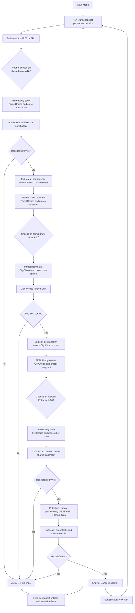
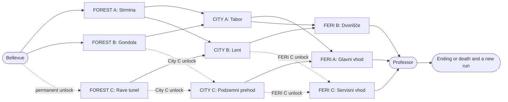
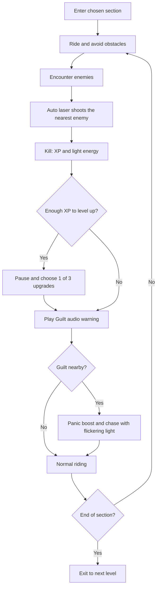

# BOKI: LATE TO FERI — Gameplay

This document specifies the decision system and gameplay loop. See [Story.md](Story.md) for scenes, dialogue, and atmosphere, and [Architecture.md](Architecture.md) for Unity architecture and implementation.

## 0. Gameplay Pillars and Controls

**Core loop:** Boki rides an electric scooter through branching routes. An automatic rave laser kills enemies, whose drops recharge the light battery and grant XP. Choosing a route immediately locks the alternatives. Guilt pursues him periodically. After three levels, he fights the professor. Death resets temporary progress; permanent C-route unlocks remain.

| Control | Action |
|---|---|
| `WASD` | Move / steer the scooter |
| Mouse | Rotate the third-person camera |
| `Space` | Jump |
| `Left Shift` | Short **boost** (the consistent term; do not call it “dash”) |
| `E` | Interact with the `POWER OFF` panel and other interactive objects |
| `Esc` | Pause / back |
| Automatic | Laser targets the nearest enemy in range; contact collects XP and battery drops |

**Visual target:** low-poly PS1/VHS horror, with obstacles and attacks readable even on Low settings. **Successful run duration:** approximately 7–12 minutes, including the boss.

**Status:** values and designs here are an initial specification, not evidence that these systems already exist in the Unity project.

## 1. Main Gameplay Flowchart



**Rules:** no return to a previous scene during the same run. HP, battery, and upgrades carry into the next level. **A newly unlocked C route becomes available only at the start of the next run.** Entering the chosen section immediately records the choice and locks the other gates in that level; do not wait until the section ends.

**Time budget:** prologue 20–30 s (skippable) + Pohorje 2–3 min + Maribor 3–4 min + FERI approach 1–2 min + professor 1–2 min = approximately **7 min 20 s – 11 min 30 s** with the prologue. The target is **7–12 min**; the boss is counted once.

## 2. Branching Route Graph



A solid line is available when its source route is chosen. A dashed line also requires the corresponding permanent unlock. **Every connection not shown is locked in the current run**, even if the player has all permanent unlocks.

## 3. Allowed Route Matrix

| Previous choice | Allowed next A/B/C routes | Locked by previous choice |
|---|---|---|
| `F_A` | `C_A`, `C_B` | `C_C` |
| `F_B` | `C_A`, `C_C`* | `C_B` |
| `F_C`* | `C_B`, `C_C`* | `C_A` |
| `C_A` | `E_A`, `E_B` | `E_C` |
| `C_B` | `E_B`, `E_C`* | `E_A` |
| `C_C`* | `E_A`, `E_C`* | `E_B` |

`*` requires the corresponding globally unlocked secret route.

**Important:** combinations such as `F_B -> C_C -> E_A` require `C_C` to have been permanently discovered. A choice such as `F_B -> C_B` is **never allowed**, even though City B is open by default. This distinction separates the two kinds of lock.

### 3.1 First Run and Visible Branching

All three C routes start locked, so `F_B` **temporarily forces** `C_A`, and `C_B` **temporarily forces** `E_B`. This is intentional: it shows the consequences of unlocking routes. The design does **not** guarantee two open options at every first-run fork. Demonstrate `F_A`, which offers `C_A` or `C_B` in Maribor, or show a second run with C routes unlocked.

Guaranteeing at least two active choices at **every** first-run fork would require changing the connection matrix or unlocking C routes earlier. Do not make that change just before the jam deadline: it requires updates to the flowchart, `RouteManager`, and all route tests.

## 4. Game State and Saving Rules

### PersistentState — PlayerPrefs or Small JSON

```text
unlockedForestC: bool = false
unlockedCityC:   bool = false
unlockedFeriC:   bool = false
```

Copy these flags into `RunState.availableUnlocks` at the start of a new run. **Use the copied flags**, not newly changed global values, so C routes cannot open during the run in which they were discovered.

### RunState — Reset on Death or New Run

```text
forestChoice: null | A | B | C
cityChoice:   null | A | B | C
feriChoice:   null | A | B | C
health:       100
battery:      100
xp:           0
upgrades:     []
killCount:    0
startTime:    ...
availableUnlocks: snapshot of persistent unlocks
```

### Gates and Messages

Each fork has these states:

- `AVAILABLE`: bright visible sign, gate open.
- `PERSISTENT_LOCK`: padlock and “DISCOVER ON ANOTHER RUN”.
- `ROUTE_LOCK`: dark roots / shadowed gate and “SEALED BY YOUR PREVIOUS PATH”.
- `SELECTED`: chosen route; the other routes in this scene close immediately.

**Lock display priority:** first check the connection from the previous choice (`ROUTE_LOCK`), then the permanent unlock (`PERSISTENT_LOCK`), otherwise `AVAILABLE`. If both locks apply, display **`ROUTE_LOCK`** and give the player one clear explanation. `SELECTED` applies only after crossing the actual selection trigger.

**Physics / UX:** `ROUTE_LOCK` and `PERSISTENT_LOCK` require an enabled blocking collider, a disabled selection trigger, and the correct message when crossing is attempted. `AVAILABLE` requires a passable entrance and an active trigger. Once the player chooses, immediately close the alternatives and prevent a second choice.

Choosing `A/B/C` requires no extra menu confirmation: entering an allowed **fork trigger** selects it. Forbidden gates need physical colliders, not just closed visuals, so their behavior is consistent and readable.

### RouteManager Pseudocode

```csharp
// At the start of a new run:
run.availableUnlocks = savedUnlocks.Clone();

bool IsCityAllowed(CityRoute city)
{
    bool linked = forestChoice switch {
        ForestRoute.A => city == CityRoute.A || city == CityRoute.B,
        ForestRoute.B => city == CityRoute.A || city == CityRoute.C,
        ForestRoute.C => city == CityRoute.B || city == CityRoute.C,
        _ => false
    };
    return linked && (city != CityRoute.C || run.availableUnlocks.cityC);
}

bool IsFeriAllowed(FeriRoute feri)
{
    bool linked = cityChoice switch {
        CityRoute.A => feri == FeriRoute.A || feri == FeriRoute.B,
        CityRoute.B => feri == FeriRoute.B || feri == FeriRoute.C,
        CityRoute.C => feri == FeriRoute.A || feri == FeriRoute.C,
        _ => false
    };
    return linked && (feri != FeriRoute.C || run.availableUnlocks.feriC);
}

// On successfully leaving the forest:
savedUnlocks.forestC = true;
SavePersistentUnlocks();
// On leaving the city:
savedUnlocks.cityC = true;
SavePersistentUnlocks();
// On first entering the boss arena:
savedUnlocks.feriC = true;
SavePersistentUnlocks();
```

Forest C requires `run.availableUnlocks.forestC`; A and B are always open. At each fork, immediately save `forestChoice`, `cityChoice`, or `feriChoice`, close the other gates, and let the player continue along the chosen route. **Never reset the choice before loading the next scene.**

## 5. Loop Within Each Route



**Keep Guilt AI simple:** use `Distant -> Warning -> Chase -> Reposition`. Spawn at one of 2–3 marked points behind the player while offscreen. If stuck on geometry or too far away, reposition invisibly to the next point. Disable Guilt AI during the boss and use only a decorative mesh.

## 6. Content and Enemy Progression by Level

| Level | Main hazards | Enemies | Guilt | Maximum regular enemies | Focus |
|---|---|---|---|---:|---|
| Pohorje | Trees, logs, visual ground pits | `Melee`, then late `Ranged` | Short chase | 8 | Movement tutorial, forest emphasis |
| Maribor | Wreckage, cars, fences | Same 2 AI types, more HP and ranged enemies | Longer chase | 12 | Greater combat pressure |
| FERI | Doors, ramps replacing stairs, warning circles | Reskins of the same 2 AI types | Final corridor appearance | 8 | Professor boss |

**Enemy progression uses shared AI, not three separate systems:**

- `MeleeChaser` follows Boki and deals contact damage nearby. Forest: dark shadow; city: `Izgubljeni meščan`; FERI: student shadow.
- `RangedShooter` fires slow projectiles toward Boki on a cooldown. Forest/city: Watcher; FERI: floating exam papers using the same AI and projectile system.
- `GuiltChaser` is immortal, uses separate logic, and stays mostly offscreen. Nearby, it grants +25% panic speed for 2 s with a 5 s cooldown and increases pressure.
- `ProfessorBoss` uses Exam Barrage and Deadline Slam. Different entrances change only a small boss setting.

## 7. Branch Configurations

| Route | Environment / distinct experience | Reward / cost |
|---|---|---|
| `F_A` Strmina | Slalom through trees, more melee hordes | More XP and combat |
| `F_B` Gondola | Slope, obstacle jumps, less combat | Faster, less XP |
| `F_C` Rave tunel | Narrow dark tunnel, light glitches | Guaranteed pickup, greater battery pressure |
| `C_A` Tabor | Overturned cars, strong melee groups | Plenty of XP |
| `C_B` Lent | Riverbank and distant ranged enemies | More battery pickups |
| `C_C` Podzemni prehod | Shorter tunnel and Guilt set piece | Fast route, risk from darkness |
| `E_A` Glavni vhod | Corridors and melee | Standard boss |
| `E_B` Dvorišče | Ambush and side corridor | 2 additional melee enemies at 50% boss HP |
| `E_C` Servisni vhod | Traps and electrical panel with `POWER OFF` switch | Activating `POWER OFF` starts the boss at 85% HP |

**Design rule:** each of the three scenes has **one shared start, a fork into short variants, and one shared ending**. Do not build nine full environments for nine variants.

## 8. Performance Target and Unity Settings

See [README.md](../README.md#development-setup) for the target machine. Assume integrated graphics with no discrete GPU.

- **Target build:** Windows x86_64, 1280 × 720, Low settings. Target at least 30 FPS in the worst section; 60 FPS is a stretch goal to verify on the actual machine.
- **Renderer:** URP Forward; lower render scale if needed, e.g. 0.75–0.9. Do not use HDRP or volumetric fog.
- **Lights:** approximately 1 main directional light and only a few active local lights in view. Disable real-time shadows on additional lights. The flashlight can combine one simple Spot Light with a transparent circle visualization, without expensive shadow casting.
- **Visibility:** local fog and limited geometry; do not render entire streets behind fog. Reuse prefab models.
- **Enemies:** cap at 8 / 12 / 8. Use simple colliders, no ragdolls, no expensive physics scripts per enemy, and small spawn batches.
- **Effects:** low-resolution textures, particles only on hits, restrained grain/glitch effects, and toggles where needed.
- **Measurement:** make a Windows build and test on the target Radeon graphics early. Record FPS during the Maribor horde, boss fight, and scene with the most lights.

## 9. Implementation Priorities for Two Developers in 48 Hours

### Required First

1. `ScooterController`, third-person camera, jump, boost.
2. `AutoLaser`, HP, one melee enemy script, death/reset.
3. `RouteManager`: selection, gate closure, connection table.
4. `PersistentUnlocks`: 3 flags, saving, milestone unlocks.
5. Three graybox scenes with at least A/B branches that offer different routes before polish.
6. Ranged enemy, Guilt chase, light/battery.
7. Professor boss, victory, ending.

### Only Then

- C branches (short and built from reused modules), full upgrade UI, PS1/VHS polish, intro, humor, additional sounds.

### Work Split

- **Programmer 1:** movement, camera, weapon, enemies, Guilt, boss, balancing data.
- **Programmer 2:** level graybox, modular prefabs, route gates and triggers, UI, audio, PS1 style, scene integration.
- **Together at the halfway point:** complete the first run from Bellevue to at least a classroom prototype. Do not wait for finished models.

## 10. Acceptance Tests (Manual Checks)

- [ ] First run: Forest A and B open, Forest C locked.
- [ ] Every reachable combination of previous route and permanent unlocks offers at least **one** allowed next exit, with no dead ends.
- [ ] First run, Forest A: City A and B open, C closed.
- [ ] First run, Forest B: City A open; City B blocked by the route choice; City C blocked by its permanent lock.
- [ ] First-run `F_B`: City A is the only allowed choice. At `C_B`, `E_B` is the only allowed choice. UI does not promise a false choice.
- [ ] `PERSISTENT_LOCK`: before permanent unlock, C gates show `DISCOVER ON ANOTHER RUN`; a blocking collider prevents crossing and the selection trigger does not fire.
- [ ] `ROUTE_LOCK`: gates forbidden by the previous choice show `SEALED BY YOUR PREVIOUS PATH`, have a blocking collider, and do not fire the selection trigger.
- [ ] If both locks apply, display `ROUTE_LOCK`.
- [ ] Entering an allowed fork trigger saves the route **immediately**, closes the alternatives, and prevents another choice in the same level.
- [ ] Completing the forest for the first time and then dying opens Forest C in the **next** run.
- [ ] Completing the city makes City C globally available only at the next run start.
- [ ] `F_C` allows `C_B` or unlocked `C_C`, never `C_A`.
- [ ] `C_A` allows `E_A` or `E_B`, never `E_C`, even if globally unlocked.
- [ ] `C_B` allows `E_B` or unlocked `E_C`, never `E_A`.
- [ ] `C_C` allows `E_A` or unlocked `E_C`, never `E_B`.
- [ ] Death resets HP, XP, upgrades, and route choices, but keeps permanent C unlocks.
- [ ] Every allowed FERI route reaches the same classroom; the professor fight remains completable.
- [ ] `E_B` adds 2 melee enemies at half boss HP; `E_C` with `POWER OFF` lowers starting boss HP.
- [ ] The laser automatically shoots the nearest target; killed enemies restore light energy.
- [ ] At 0 battery, enemies move faster and recovery remains possible.
- [ ] The Windows build remains playable during the Maribor horde and boss arena on the target Ryzen 5600G / Radeon / 16 GB machine.

## 11. Three Example Runs

- **First run:** `F_A → C_B → E_B → Boss`. Leaving the levels unlocks all three secret C routes for future runs if the player reaches the boss arena.
- **Second run:** `F_C → C_C → E_C → Boss`. Three secret routes, including the short service corridor.
- **Third run:** `F_B → C_A → E_A → Boss`. Alternatives are closed according to the matrix despite saved unlocks.

**System goal:** successive route choices have consequences. The first run includes forced continuations; later runs offer more open routes. Permanent unlocks create progression while keeping the system manageable for two developers in 48 hours.
