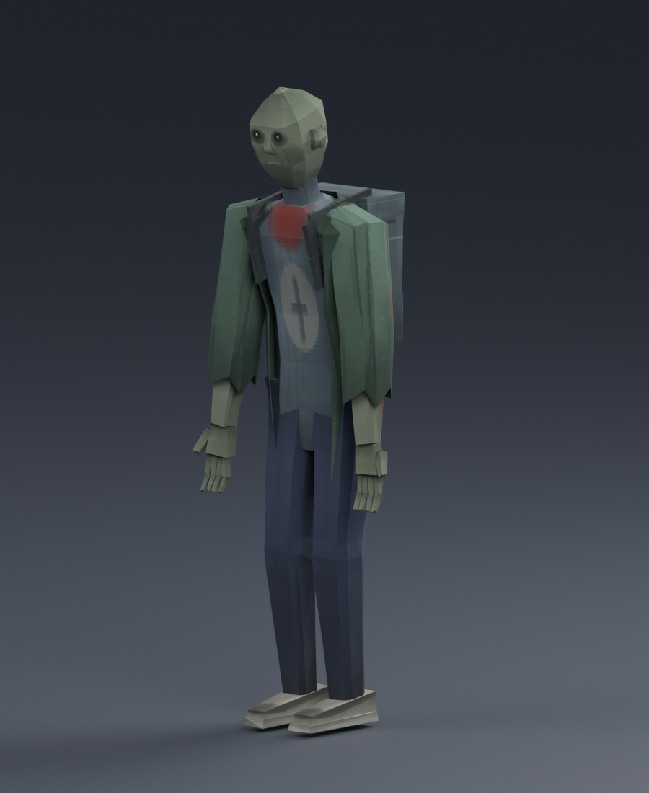
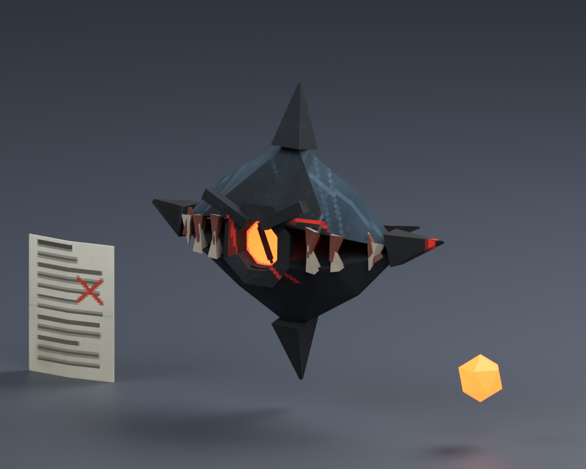

# Enemy models — PS1 / early PS2 low-poly

Editable Blender models built from the [melee family](../character-modeling-v2/references/03-melee-family.png), [Watcher + exam paper](../character-modeling-v2/references/04-watcher-and-papers.png), [Guilt](../character-modeling-v2/references/05-guilt.png) and [professor](../character-modeling-v2/references/06-professor-orthographic.png) / [lectern](../character-modeling-v2/references/07-professor-action-and-props.png) sheets. Same pipeline and conventions as the [player model](../player-model-v1/README.md): meters, Blender −Y forward / +Z up (FBX exports −Z forward / +Y up), flat-shaded faces, nearest-filtered hand-painted atlases (soft gradients, grime, stains and cloth folds, posterised to 2 px blocks for a PS1 crunch), no normal maps, transparency, cloth or dynamic lights, at most two bone influences per vertex.

 

## Deliverables

| Asset | FBX (in `Export/`) | Blend (in `Source/`) | Tris | Atlas (in `Textures/`) | Clips |
| --- | --- | --- | ---: | --- | --- |
| Melee body + add-ons, 1.85 m | `CHR_Melee.fbx` | `CHR_Melee.blend` | body **1,204**, jacket **198**, backpack **84** | `T_Melee_{Forest,Rust,Student}_BaseColor.png`, 512² | `Melee_Idle`, `Melee_Pursuit`, `Melee_Contact`, `Melee_Hit`, `Melee_Death` |
| Watcher, 0.55 m body, 0.72 m with spikes | `CHR_Watcher.fbx` | `CHR_Watcher.blend` | shell **332** + eye **28** | `T_Watcher_{Forest,City}_BaseColor.png` 256², `T_Watcher_Eye.png` 64² | none |
| Watcher projectile | `PROJ_WatcherOrb.fbx` | (in Watcher blend) | **20** | `T_Watcher_Eye.png` | none |
| Exam paper, 0.21 × 0.30 m | `PROP_ExamPaper.fbx` | (in Watcher blend) | **20** | `T_ExamPaper_BaseColor.png`, 256² | none |
| Guilt, 4.20 m | `CHR_Guilt.fbx` | `CHR_Guilt.blend` | **1,368** | `T_Guilt_BaseColor.png`, 256² | `Guilt_Warning`, `Guilt_Chase`, `Guilt_BossShadow` |
| Professor, 1.78 m | `CHR_Professor.fbx` | `CHR_Professor.blend` | body **1,358** + glasses **132** | `T_Professor_BaseColor.png`, 512² | `Professor_Idle` |
| Lectern | `PROP_Lectern.fbx` | (in Professor blend) | **48** | `T_Professor_Props.png`, 128² | none |
| Floor ring | `PROP_FloorRing.fbx` | (in Professor blend) | **128** | `T_Professor_Props.png` | none |

Previews of every asset are in [Previews/](Previews/): turnarounds, pursuit/contact/death poses, [Guilt next to Boki](Previews/guilt-vs-boki.png) (2.44× height) and the [professor at the lectern](Previews/professor-at-lectern.png). Measured values: [validation.json](validation.json) (authoring) and [export-validation.json](export-validation.json) (reimported FBX).

All counts are below the proposed budgets' upper bounds, so there is room to add detail later. Melee body (1,204) and Guilt (1,092) are inside their proposed ranges; the Professor (1,490 with glasses) is slightly under the 1,600 lower bound.

## Second pass (cleanup)

The first pass was a blockout. This version adds: shoulders and pelvis that blend into the body (no boxy shoulders or hip shelf), curled two-segment fingers, soled shoes, nose / ears / brow on the melee head, a painted sunken-eyed face on the melee skins (the Forest shadow keeps only faint glints), and painted atlases with stains, folds and per-skin colour. Melee atlases are now 512² (was 256², over the 256² proposal); everything is still one material per skin. Guilt stays featureless by design.

## Shared rig

Melee, Guilt and the Professor use the **same 22-bone Generic skeleton** (`root`, `hips`, `spine`, `chest`, `neck`, `head`, and `clavicle`, `upper_arm`, `lower_arm`, `hand`, `thigh`, `shin`, `foot`, `toe` each with `.L` / `.R`), scaled to the character. Unlike the player rig, sides are **anatomical**: `.L` is the character's left (+X in Blender). Clips are in place with no root motion; the gameplay controller owns displacement.

## Per-asset notes

- **Melee.** One skinned body and one rig shared by every reskin. `M_Melee_Jacket` (open front, ragged hem and cuffs) and `M_Melee_Backpack` (rigid, chest bone) are separate meshes in the same FBX; the three atlases share one UV layout so a reskin is a material swap:
  - Forest shadow: body only, `T_Melee_Forest`.
  - Izgubljeni meščan: body + jacket, `T_Melee_Rust`.
  - Student shadow: body + jacket + backpack, `T_Melee_Student`.
  
  The FBX references the Forest atlas; disable the add-on child meshes per prefab. The jacket is 198 triangles, inside the proposed 200-triangle add-on cap.
- **Watcher.** A menacing version of the sheet's diamond: `M_WatcherShell` (two halves with a front slit, apex horns, side spikes, rear barbs, six teeth per lip, angry brow lids and a recessed bezel) and `M_WatcherEye` (slit-pupil red disc, own material slot) under an empty root. The body keeps the 0.55 × 0.24 × 0.40 m size; spikes extend the overall width to 0.72 m and the shell is 332 triangles, **above** the sheet's 120–240 budget by request. If that is too heavy for crowds, drop the teeth prisms in `build_watcher.py`. The eye points along Blender −Y; `Socket_ProjectileOrigin` sits at the eye. `City` skin is `T_Watcher_City`, and both skins have painted red cracks. The orb and paper are separate props. The paper is a closed, shallow, once-bent sheet with painted front (red ✗) and back (red ring). The boss's three-sheet barrage can reuse it. In the `.blend`, the orb and paper are placed beside the Watcher above the floor for viewing; the FBX props are at the origin.
- **Guilt.** Featureless head (no eyes or teeth, per the sheet), deep hunch, long-arm silhouette, ridged spine and shoulder spurs, tattered shadow rags on elbows and waist, and 0.68 m spidery claws with pale tips (sheet proposes 0.45 m hands; longer on request for menace, 1,368 triangles vs the 900–1,400 budget). The decorative boss shadow reuses the held pose `Guilt_BossShadow`. A separate flat wall-shadow silhouette was **not** authored. Silhouette height is not a collider height; there is no death clip because Guilt is invulnerable.
- **Professor.** Jacket over open-front shirt, belt, loafers, painted tired face, horseshoe hair with bare crown. `M_Glasses` is a separate rigid mesh on the head bone; it is frames only, because lenses would need transparency and would hide the painted eyes. `Professor_Idle` holds both hands on the lectern. Place `PROP_Lectern` (floor-centre origin) at professor-local **(0, 0.45 m forward, 0)** (the `.blend` already has it there); the reading surface is about 1.02–1.10 m high. `PROP_FloorRing` is a unit-radius flat ring (outer 1.0 m, inner 0.92 m): scale it in Unity and give it an emissive red material.

## Not delivered

- Professor gestures from the sheet: raise & release sheets, deadline slam, victory glasses-adjust. Only the idle is authored.
- Watcher `Hover` / `Fire` and paper `Float` / `Fly` clips. The sheet marks these as optional transform motion, so animate them in Unity.
- Guilt wall-shadow silhouette mesh, exam-sheet stack, collider shapes and any Unity prefab, Animator or AI wiring.

## Unity handoff — pending import

These sources live outside `Game/Assets`. No Unity `.meta` files were generated and no prefab, scene, collider or controller was changed. Import in the project's pinned **Unity 6000.6.7f1** so the Editor generates GUIDs; do not hand-author `.meta` files. Follow the numbered steps in the [player handoff](../player-model-v1/README.md#unity-handoff--pending-import) and [UNITY_HANDOFF.md](../character-modeling-v2/UNITY_HANDOFF.md), plus:

1. Copy `Export/` and `Textures/` together into an art folder under `Game/Assets`. Import characters as **Generic**, create each Avatar from its model, use `root` as the motion node and disable root motion. Clip names are the take names after the `|` in Blender's import (e.g. `CHR_Melee|Melee_Pursuit`); set Loop Time on `Melee_Idle`, `Melee_Pursuit`, `Guilt_Warning`, `Guilt_Chase`, `Professor_Idle`.
2. Confirm facing (+Z forward, +Y up) and unit scale with a one-metre cube. The Blender FBX round-trip is verified; Unity's importer is **not**.
3. Create URP/Lit materials per atlas: opaque, low smoothness, texture Filter Mode **Point**, Wrap Clamp, compression off initially. Watcher eye, orb and floor ring need an **emission** material; the Blender emission link is preview-only. Do not add real-time lights for them.
4. Keep gameplay colliders, AI and movement on the root outside the model. No ragdoll or cloth.
5. Review silhouettes in the actual fog and lighting, then performance in a Windows player on the Ryzen 5600G. No in-engine or target-hardware result is claimed.

## Checks performed

- Rendered and inspected every asset in Blender 5.2.3 LTS (bind poses, animated poses, skin variants and scale comparison against the player).
- All skinned vertices have normalized weights, at most two influences and no missing assignments.
- Reimported all eight actual FBX files into clean Blender scenes and asserted: triangulated, finite coordinates, 22-bone skin, every expected clip present, correct height (melee 1.886 m, Guilt 4.21 m, Professor 1.782 m) and Watcher width 0.724 m, plus the projectile socket.

Rebuild (each script creates its own scene and replaces its own generated files):

```sh
B=/Applications/Blender.app/Contents/MacOS/Blender
for s in melee watcher guilt professor; do $B --background --python output/enemy-models-v1/Source/build_$s.py; done
$B --background --python output/enemy-models-v1/Source/verify_exports.py
```

`build_guilt.py` also imports `../player-model-v1/Export/CHR_Boki_BindPose.fbx` for the scale render if it exists. Canonical rules stay in [Story.md](../../docs/Story.md) and [Gameplay.md](../../docs/Gameplay.md); this asset does not change them.
