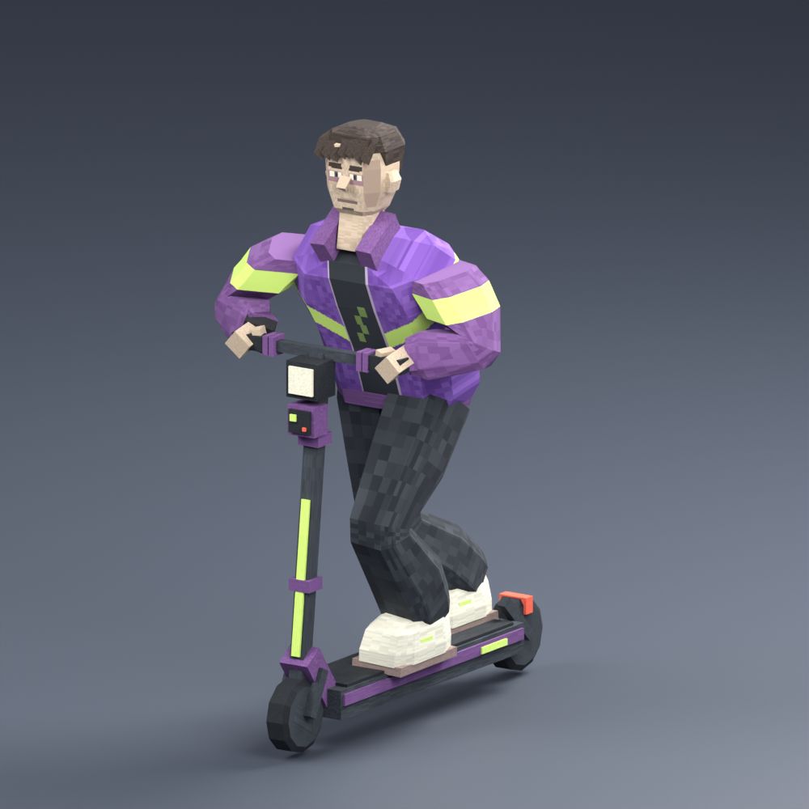

# Boki — PS1 / early PS2 low-poly player

Editable Blender model built from the [Boki turnaround](../character-modeling-v2/references/01-boki-orthographic.png) and [rider/scooter sheet](../character-modeling-v2/references/02-player-riding-and-scooter.png). Preserves the purple windbreaker, lime chevron, dark baggy trousers, pale trainers, tired face, chunky dark hair and left-wrist digital watch. The scooter includes the headlight, laser box and rear reflector.



## Deliverables

- [Source/CHR_Boki.blend](Source/CHR_Boki.blend): editable mesh, 22-bone Generic rig, packed texture, riding pose and separate review studio. Open in Blender 5.2.3 LTS or newer compatible Blender. The original connected Blender scene was preserved.
- [Export/CHR_Boki.fbx](Export/CHR_Boki.fbx): skinned character and a 30-frame, 30-fps held riding loop. The FBX take imports into Blender as `CHR_Boki|Boki_Lowpoly_Studio`; name its Unity clip `Boki_RideIdle`.
- [Export/CHR_Boki_BindPose.fbx](Export/CHR_Boki_BindPose.fbx): same skeleton and skin in neutral A pose, without animation. Use this for further animation authoring or rig inspection.
- [Export/PROP_Scooter.fbx](Export/PROP_Scooter.fbx): frame, steering assembly and two wheels, with axle pivots, grip/foot guides, headlight and muzzle sockets. All roots share the same ground origin for assembly.
- [Textures/T_Boki_BaseColor.png](Textures/T_Boki_BaseColor.png): shared 512 × 512 pixel-painted atlas. Also packed into the Blender file; no external image dependency when opening it.
- [Previews/](Previews/): rendered three-quarter, side, back and neutral-pose views.
- [validation.json](validation.json) and [export-validation.json](export-validation.json): measured authoring and FBX round-trip results.

## Measured budgets

| Item | Result |
| --- | ---: |
| Boki | 724 source vertices / **1,273 triangles** |
| Scooter | **628 triangles**, four meshes |
| Combined | **1,901 triangles** |
| Materials | One shared atlas material |
| Texture | One 512² base-color atlas, nearest filtering |
| Skeleton | 22 bones; maximum two influences per vertex |
| Standing height | 1.72 m, ground to crown |
| Riding crown | 1.653 m above ground |

The single character mesh contains separate overlapping clothing/rigid components. It is intentionally not a watertight sculpt or a facial-animation topology. Broad facets, eight-sided limb cross-sections, 12-sided wheels, grouped hands, painted eyes/stubble and chunky hair keep the retro silhouette inexpensive. Quads remain editable in the source; modifiers triangulate the exported meshes. There are no normal maps, transparent lenses, dynamic lights, cloth or simulated scooter physics. Sharing a material does not combine the skinned character and four prop meshes into one draw call.

## Unity handoff — pending import

These source assets live outside `Game/Assets`. No Unity `.meta` files have been generated and no player prefab, scene, collider, controller or project setting was changed. Import in the project's pinned **Unity 6000.6.7f1** so the Editor generates the asset GUIDs; do not hand-author `.meta` files.

1. Copy `Export/` and `Textures/` together into a new art folder under `Game/Assets`, keeping their relative layout. Import FBX files directly; retain the `.blend` outside Assets to avoid an automatic Blender conversion dependency.
2. Inspect scale and facing with a one-meter reference cube: authoring uses Blender -Y forward / +Z up in meters; FBX exports -Z forward / +Y up. Confirm the **Unity result** is +Z forward / +Y up with unit gameplay-root scale before wiring it. The Blender FBX round-trip is verified; Unity's importer is not.
3. Import Boki as **Generic**, create its Avatar from this model and use `root` as the motion node. Disable root motion. Use animation frames 1–30, name the clip `Boki_RideIdle`, and enable Loop Time. This clip holds the riding pose; it is not a full animation set or breathing cycle. Do not assume Humanoid retargeting is configured.
4. Create one URP/Lit material with the atlas as Base Map, opaque surface and low smoothness. Assign it to Boki and the scooter meshes. Set texture Filter Mode to **Point**, Wrap Mode to Clamp, Max Size 512, and disable compression initially to retain pixel detail. Compare mipmaps on/off in motion before choosing the shipping setting. Preserve imported normals for flat shading.
5. In an owned test prefab/scene, place character and scooter under a visual-only child of the movement root, both at zero position/rotation and unit scale. The Animator belongs on the character visual hierarchy. Disable visual placeholders only in that owned copy. Leave the CharacterController and CameraPivot on their existing gameplay hierarchy. Do not alter capsule dimensions to compensate for an art import error.
6. `Steering` is located at the lower stem. Its assembly, front wheel and grip/light/muzzle markers are children. Wheels have axle-centered origins and roll about local X. Foot guides remain on the deck. The wristwatch is rigidly weighted to `hand.L`.
7. Inspect feet on the deck and hands on the grips, then test sharp turns, boost, jumps, collisions, near walls and camera obstruction. The held ride pose and grouped hands are a first modeling pass; finger curl, moving steering contacts and additional clips still need animation work. Connect animation to the project's existing movement presentation path after reviewing current code; this delivery adds no Animator controller or gameplay adapter.
8. Review in an actual Windows player on the Ryzen 5600G. No target-hardware performance or Windows validation is claimed.

## Checks performed

- Rendered and inspected front three-quarter, side, rear and A-pose views in Blender 5.2.3 LTS; opened the model in the connected Blender in a separate review scene.
- All character vertices have normalized weights, at most two influences, and no missing skin assignments.
- Reimported all three actual FBX files into clean Blender scenes. Verified triangle counts, triangulation, 22-bone skin, finite coordinates, correct standing height, riding bounds matching the source within 0.1 mm and front/rear wheel world pivots.
- The riding root remains fixed. The approximately 1.65 m crown fits below the reference pack's 1.8 m capsule height; shoulder/arm clearance still needs the movement test above.
- Studio floor, camera and lights are excluded from the FBX exports.

Rebuild with Blender's executable (the script creates its own scene):

```sh
blender --background --python output/player-model-v1/Source/build_player.py
blender --background --python output/player-model-v1/Source/verify_exports.py
```

On macOS the executable can be `/Applications/Blender.app/Contents/MacOS/Blender`. Rebuilding replaces this pack's generated files. Canonical game rules remain in [Story.md](../../docs/Story.md) and [Gameplay.md](../../docs/Gameplay.md); this asset does not change them.
